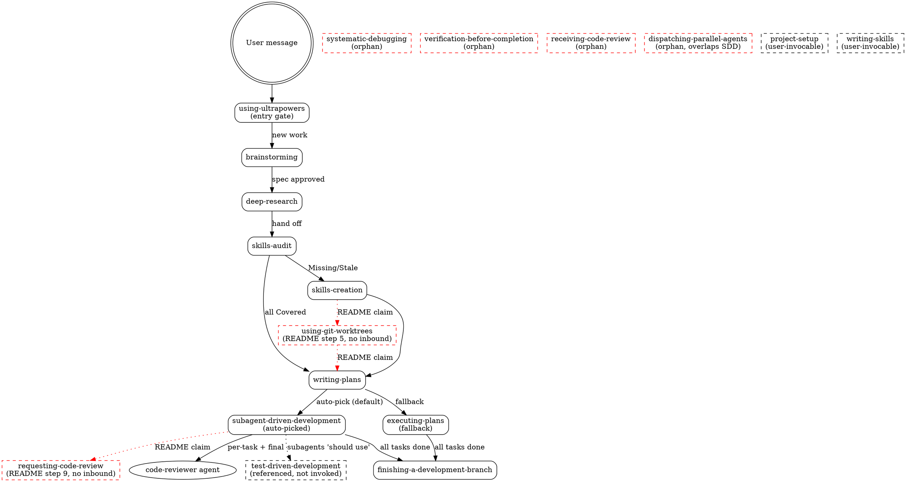

# Ultrapowers System Audit — Findings Report

**Date:** 2026-04-24
**Spec:** `docs/ultrapowers/specs/2026-04-24-ultrapowers-system-audit-design.md`
**Status:** Complete

---

## 1. Executive summary

Seven parallel audit subagents produced **74 distinct findings** across the Ultrapowers plugin's 18 skills, 1 agent, hooks, manifests, and four harness integrations. Dedup merged zero findings — each lane surfaced non-overlapping evidence, confirming the lane design isolates concerns well. Severity breakdown: **3 blocker, 15 high, 26 medium, 30 low**. Lane A (skill quality) produced **44** findings, Lane B (workflow coverage) **10**, Lane C.1 (dogfood) **8**, Lane C.2 (harness parity) **12**.

### Three shipping-critical takeaways

1. **README 1.2 lies about workflow defaults.** The README claims auto-commit and auto-push are ON by default; all three execution skills (`writing-plans`, `subagent-driven-development`, `executing-plans`) still say defaults are OFF. This is a user-facing contract break — users who trust the README will have behavior that doesn't match what the skills actually do. Quick-win fix (change skill docs to match README, which is also the actual prefs-file default).

2. **Non-Claude-Code harness manifests are stuck at pre-reset versions.** Cursor manifest is `5.0.2`, Gemini is `5.0.0`, while README/Claude manifest show `1.2.0`. The `.version-bump.json` lists both files, so either the bump script has a bug or it wasn't run for this release. Secondary issue: Cursor's manifest advertises `commands/` and `agents/` paths that don't exist as Cursor-native content. These are the kind of bugs that silently embarrass the project when a Cursor user tries the plugin.

3. **The pipeline has no fast-path for trivial work.** Lane C.1's dogfood of a 2-line `/health` endpoint produced **11 user-attention moments**, **3 persisted documents**, and **~8 planned subagent dispatches**. The `brainstorming` HARD-GATE explicitly forbids shortcuts for simple tasks; `deep-research` runs 100% of the time even on topics (Express health checks) that have been stable for 15 years. Lane B confirmed this structurally: four task shapes (bugfix-only, docs-only, refactor-only, one-liner) have no reduced-flow entry points. Users either skip the pipeline for small work or endure full ceremony.

### Recommended first action

Start with **punch-list item #1 (A-BATCH2-001)** — the README/skills workflow-prefs contract break. It's a blocker, it's quick-win (S effort), and it's literally a doc update to match what the preferences file already does. Resolving it closes the most visible user-facing inconsistency in 1.2. 

### Scope limits (read before acting)

- **Lane C.1 (dogfood) is a single walkthrough** of one fixed scenario + a short variant probe. It surfaces friction in the feature-build flow but does not exhaustively test all task shapes. Rerunning with different scenarios would likely surface more friction.
- **Lane C.2 (non-CC harnesses) is static-only** — we cannot live-execute Codex, Cursor, OpenCode, or Gemini from this session. Manifest validity and skill-body portability are checked; actual runtime behavior on those harnesses is unverified.
- **Sibling pack repositories** (`ultrapowers-dev`, `ultrapowers-business`) are **out of scope** — separate lifecycles.
- **Upstream divergence from `obra/superpowers`** is **out of scope** — tracked separately in `docs/ultrapowers/upstream-sync-log.md`.

---

## 2. Punch list (top 20)

Sorted by: severity descending, then effort ascending (quick-wins first), then lane order, then ID. **17 of the top 20 are quick wins** (severity ≥ medium, effort S). Every row links to its full entry in the appendix.

| # | Severity | Rubric | Effort | ID | Title | Quick win? | Appendix |
|---|---|---|---|---|---|---|---|
| 1 | blocker | 2 | S | `A-BATCH2-001` | autoCommit/autoPush default contradicts README contract | ✅ | [→](#a-batch2-001) |
| 2 | blocker | 2 | S | `A-BATCH3-001` | verification-before-completion description summarizes workflow (rubric violation) | ✅ | [→](#a-batch3-001) |
| 3 | blocker | 2 | S | `A-BATCH3-002` | receiving-code-review description summarizes workflow (rubric violation) | ✅ | [→](#a-batch3-002) |
| 4 | high | 2+3 | S | `A-BATCH1-001` | brainstorming description violates own writing-skills rubric (no 'Use when', second person, summarizes workflow) | ✅ | [→](#a-batch1-001) |
| 5 | high | 3 | S | `A-BATCH1-002` | brainstorming step numbering is inconsistent between checklist and deep-dive sections | ✅ | [→](#a-batch1-002) |
| 6 | high | 2 | S | `A-BATCH2-002` | writing-plans mandates '@'-prefixed skill pointers that writing-skills explicitly forbids | ✅ | [→](#a-batch2-002) |
| 7 | high | 2+3 | S | `A-BATCH3-003` | test-driven-development uses forbidden @-reference that force-loads file | ✅ | [→](#a-batch3-003) |
| 8 | high | 2+3 | S | `A-BATCH4-001` | writing-skills violates its own `@ link` rule twice | ✅ | [→](#a-batch4-001) |
| 9 | high | 2 | S | `A-BATCH4-002` | writing-skills cites stale 1024-char frontmatter limit (spec is 1536) | ✅ | [→](#a-batch4-002) |
| 10 | high | 2 | S | `A-BATCH4-011` | code-reviewer agent description summarizes workflow and embeds Example blocks — the exact CSO anti-pattern | ✅ | [→](#a-batch4-011) |
| 11 | high | 2+3 | S | `B-001` | README step 5 (using-git-worktrees) has no upstream invocation in skill content | ✅ | [→](#b-001) |
| 12 | high | 2+3 | S | `B-002` | README step 9 (requesting-code-review) is not a pipeline step in any skill | ✅ | [→](#b-002) |
| 13 | high | 2 | S | `C1-002` | deep-research is mandatory 100% of the time, even when the topic is well-known and the research adds zero signal | ✅ | [→](#c1-002) |
| 14 | high | 2+3 | S | `C2-001` | Version incoherence across harness manifests | ✅ | [→](#c2-001) |
| 15 | high | 2 | S | `C2-002` | Cursor manifest advertises non-existent component paths | ✅ | [→](#c2-002) |
| 16 | high | 3 | M | `B-003` | No pipeline flow handles bugfix-only, docs-only, refactor-only, or one-liner tasks |  | [→](#b-003) |
| 17 | high | 2+3 | M | `C1-001` | No fast-path for trivial tasks: 5-line endpoint triggers the full 5-skill pipeline with 11 user-attention moments and 3 persisted docs |  | [→](#c1-001) |
| 18 | high | 2+3 | M | `C2-006` | Gemini skills are not discoverable at any of Gemini's tiered paths |  | [→](#c2-006) |
| 19 | medium | 2+3 | S | `A-BATCH1-003` | ${CLAUDE_SKILL_DIR} substitution is CC-only but used without platform adaptation | ✅ | [→](#a-batch1-003) |
| 20 | medium | 2+3 | S | `A-BATCH1-005` | deep-research assumes context7 MCP is available without platform adaptation | ✅ | [→](#a-batch1-005) |

---

## 3. Methodology & limits

### Dual rubric

- **Rubric 2 — Pre-release hardening:** shipping blockers, contract breaks, regressions vs. README claims.
- **Rubric 3 — OSS contributor readiness:** can a new contributor clone, navigate, and extend this?

When rubric 2 and rubric 3 conflict, rubric 2 wins. A user-facing broken contract is always worse than contributor friction; contributor onboarding is aspirational, the plugin is already in production.

### Severity matrix

| Severity | Rubric-2 (pre-release) | Rubric-3 (OSS readiness) |
|---|---|---|
| blocker | Ships broken behavior / contract break / README claim false | New contributor cannot complete reasonable task without asking maintainer |
| high | Skill fails common path / outdated recipe / silent wrong behavior | Common-area onboarding confusion; conventions undocumented |
| medium | Edge-case failure / stale reference / noisy trigger | Secondary-area friction; stylistic inconsistency |
| low | Typos / cosmetic / truly niche | Nice-to-have polish |

When a finding satisfies both rubrics, it takes the higher severity.

### Execution

Seven subagents dispatched in parallel in a single message:

- **Lane A (skill quality, 4 batches):** each batch audited 4–5 skills against `writing-skills` (primary rubric) and Anthropic's published best-practices (secondary). 44 findings total.
- **Lane B (workflow coverage):** 1 subagent built a directed graph of skill-to-skill invocations from SKILL.md content, cross-checked against README's numbered workflow, and probed for missing flows. 10 findings + pipeline diagram + orphan/dead-path/missing-flow/overlap lists.
- **Lane C.1 (Claude Code dogfood):** 1 subagent walked the pipeline on a fixed scenario (`/health` endpoint, 2-line change) + a shorter variant probe (fix a failing test). 8 findings + transcript + verbatim question log.
- **Lane C.2 (non-CC harness parity):** 1 subagent statically validated manifests and skill portability across Codex, Cursor, OpenCode, Gemini. 12 findings + parity matrix + structural issues list.

### Dedup and ranking

All 74 raw findings were checked for duplicates. Dedup rule: same `evidence` OR fuzzy title match (≥70% token overlap) + same severity. Zero duplicates found — each lane surfaced distinct evidence. Final ranking: severity desc → effort asc → lane order → ID asc.

### Limits

1. **Lane C.1 used one scenario plus one short variant.** Other task shapes (long-lived feature, multi-file refactor, security-sensitive change) were not empirically tested. Extrapolation is suggestive, not conclusive.
2. **Lane C.2 is static-only.** No live runs on Codex / Cursor / OpenCode / Gemini. Manifest structure and skill-body portability were checked; runtime behavior was not.
3. **`writing-skills` was audited by a subagent applying its own rules to itself.** Self-audit results are in the report; interpret with eyes open.
4. **Ground truth for harness manifests captures 2026-04-24 state.** Harness formats change fast; re-research is needed if this audit is revisited >3 months later.

---

## 4. Lane A — Skill quality

**44 findings** across 18 skills + 1 agent. 3 blocker, plus highs concentrated on `writing-skills` (self-audit found 4 issues including `@`-link violations of its own rule), `brainstorming` (description is second-person and summarizes workflow — triple violation of the project's own rubric), and `writing-plans` (mandates `@skill` force-loads that `writing-skills` forbids). Every skill received at least one scorecard entry.

### 4.1 Lane A summary table

| Skill / Agent | Blocker | High | Medium | Low | Total |
|---|---|---|---|---|---|
| `brainstorming` | 0 | 2 | 1 | 0 | 3 |
| `deep-research` | 0 | 0 | 1 | 1 | 2 |
| `skills-audit` | 0 | 0 | 1 | 0 | 1 |
| `skills-creation` | 0 | 0 | 0 | 1 | 1 |
| `using-ultrapowers` | 0 | 0 | 0 | 1 | 1 |
| `writing-plans` | 1 | 1 | 2 | 1 | 5 |
| `executing-plans` | 0 | 0 | 1 | 1 | 2 |
| `subagent-driven-development` | 0 | 0 | 0 | 2 | 2 |
| `dispatching-parallel-agents` | 0 | 0 | 1 | 2 | 3 |
| `test-driven-development` | 0 | 1 | 0 | 1 | 2 |
| `systematic-debugging` | 0 | 0 | 1 | 1 | 2 |
| `verification-before-completion` | 1 | 0 | 0 | 1 | 2 |
| `requesting-code-review` | 0 | 0 | 1 | 1 | 2 |
| `receiving-code-review` | 1 | 0 | 0 | 1 | 2 |
| `using-git-worktrees` | 0 | 0 | 0 | 2 | 2 |
| `finishing-a-development-branch` | 0 | 0 | 2 | 0 | 2 |
| `project-setup` | 0 | 0 | 2 | 0 | 2 |
| `writing-skills` | 0 | 2 | 1 | 1 | 4 |
| `code-reviewer.md` | 0 | 1 | 0 | 1 | 2 |
| **Total** | **3** | **7** | **14** | **18** | **42** |

_Note: 2 additional Lane A findings do not bucket to a single skill and are not in this table — `A-BATCH1-004` (orphaned `spec-document-reviewer-prompt.md` supporting file) and `A-BATCH1-010` (README omission of skills from "What's Inside > Meta"). Both are severity `low`. Total Lane A findings: 44. All 44 appear in the appendix._

### 4.2 Per-skill scorecards

#### `brainstorming`

- **[high] A-BATCH1-001** — brainstorming description violates own writing-skills rubric (no 'Use when', second person, summarizes workflow)
  - **Evidence:** `skills/brainstorming/SKILL.md:3`
  - **Finding:** The description reads 'You MUST use this before any creative work - creating features, building components, adding functionality, or modifying behavior. Explores user intent, requirements and design before implementation.' This triple-breaks the project's own authoritative rubric (skills/writing-skills/SKILL.md:149-172): (1) it does not start with 'Use when...'; (2) it is written in second person ('You MUST use this'); (3) the second sentence summarizes the skill's workflow, which writing-skills explicitly warns causes Claude to follow the description instead of reading the skill body. Because brainstorming is the first mandatory gate of the pipeline, a rubric-breaking trigger here is maximally visible.
  - **Recommendation:** Rewrite to third person, triggering-only, e.g. 'Use when the user requests a new feature, component, design, or behavior change in any project, before any implementation step.' Remove 'Explores user intent...' clause entirely (it is workflow summary). Keep under 500 chars.
  - **Effort:** S · **Rubric:** 2+3
- **[high] A-BATCH1-002** — brainstorming step numbering is inconsistent between checklist and deep-dive sections
  - **Evidence:** `skills/brainstorming/SKILL.md:21-35,153,211,285,314`
  - **Finding:** The numbered checklist (lines 21-35) lists 11 steps where step 7 = 'Scan for sibling-pack skills' and step 8 = 'Write design doc'. But the deep-dive sections say: 'Step 4 - Load or ask workflow preferences' (line 153, matches), 'Step 2 - Calibrate user tone' (line 211, matches), 'Used during Step 5 - Propose 2-3 approaches' (line 285, matches), and 'Step 8 - Scan for sibling-pack skills (runs after design is approved...)' (line 314, MISMATCH - checklist says step 7). Line 31 also references 'step 7' for profile inspiration in the spec write step, but the checklist makes profile matching part of step 5. A fresh agent following the numbered checklist will diverge from the numbers used inside the Sibling-Pack Scan section.
  - **Recommendation:** Do a pass to align all 'Step N -' headers in the deep-dive sections with the checklist numbering at lines 21-35. Fix 'Step 8 - Scan for sibling-pack skills' to 'Step 7' and adjust 'step 10' / 'step 9' references in the body to match the checklist.
  - **Effort:** S · **Rubric:** 3
- **[medium] A-BATCH1-003** — ${CLAUDE_SKILL_DIR} substitution is CC-only but used without platform adaptation
  - **Evidence:** `skills/brainstorming/SKILL.md:30,297,301,316`
  - **Finding:** Four places in brainstorming reference files via '${CLAUDE_SKILL_DIR}/sibling-pack-map.md' and '${CLAUDE_SKILL_DIR}/architecture-profile-matching.md'. Per the project's own research brief (docs/ultrapowers/specs/2026-04-23-workflow-defaults-and-sibling-integration-research-brief.md:131), ${CLAUDE_SKILL_DIR} is a Claude Code-specific substitution. On Codex, Copilot CLI, or Gemini CLI, this variable will either not expand or be passed through literally, causing the Read tool to fail to find the sibling-pack map. using-ultrapowers.md claims cross-platform support, so this is a silent contract break on non-CC harnesses.
  - **Recommendation:** Either (a) document the CC-only assumption explicitly in brainstorming's overview (add a 'Platform Notes' callout saying sibling-pack scan requires Claude Code), or (b) add a fallback instruction like 'Read ${CLAUDE_SKILL_DIR}/sibling-pack-map.md (or skills/brainstorming/sibling-pack-map.md relative to the plugin root if the variable does not resolve)'. Option (b) is preferred since the files do live next to SKILL.md.
  - **Effort:** S · **Rubric:** 2+3

#### `deep-research`

- **[medium] A-BATCH1-005** — deep-research assumes context7 MCP is available without platform adaptation
  - **Evidence:** `skills/deep-research/SKILL.md:40,69-72`
  - **Finding:** The skill lists tools in priority order as '1. context7 (resolve-library-id -> query-docs) - latest official docs; 2. WebSearch; 3. WebFetch'. context7 is an optional MCP server, not a built-in tool. The session available-tools list for this audit shows WebSearch and WebFetch as deferred tools but no context7 MCP. On a fresh install without context7, an agent will waste a turn trying resolve-library-id and failing. There is no 'if context7 not available, skip to WebSearch' instruction.
  - **Recommendation:** Add a sentence after line 72: 'If context7 is not available in this session, skip to WebSearch/WebFetch. context7 is an optional MCP dependency, not a hard requirement.' Consider making it a bulleted note under 'Research Using Available Tools'.
  - **Effort:** S · **Rubric:** 2+3
- **[low] A-BATCH1-006** — deep-research flowchart uses diamond shape for a non-decision node
  - **Evidence:** `skills/deep-research/SKILL.md:32`
  - **Finding:** 'Cross-reference multiple sources' [shape=diamond] is shaped as a decision node, but it is a linear process step (the actual decision 'Gaps remain?' is the very next node). writing-skills/SKILL.md:292-302 specifies that diamonds should be used only for decision points. This is a small semantic noise issue in the flowchart.
  - **Recommendation:** Change 'Cross-reference multiple sources' to [shape=box] in the DOT block at line 32.
  - **Effort:** S · **Rubric:** 3

#### `skills-audit`

- **[medium] A-BATCH1-007** — skills-audit relies on <system-reminder>-injected available-skills list without CC fallback
  - **Evidence:** `skills/skills-audit/SKILL.md:109,111`
  - **Finding:** The skill instructs agents to 'Check the available-skills list in the current session (injected as <system-reminder>)'. This injection mechanism is Claude Code specific. On Codex or Gemini, there is no <system-reminder> with a list of skills to scan. The skill does not describe a fallback (e.g., listing the .claude/skills/ directory, reading plugin.json manifests). On non-CC harnesses, the agent will silently classify every non-obvious competency as 'Missing' even when sibling-pack skills are installed.
  - **Recommendation:** Add a platform note below line 111: 'Non-CC platforms: enumerate installed skills by listing ~/.claude/skills/, .claude/skills/, and any plugin skills directories directly (Codex/Copilot paths differ — see using-ultrapowers references).' Or add a reference to the mapping files at skills/using-ultrapowers/references/.
  - **Effort:** S · **Rubric:** 2+3

#### `skills-creation`

- **[low] A-BATCH1-009** — No issues found in skills-creation
  - **Evidence:** `skills/skills-creation/SKILL.md:1-117`
  - **Finding:** Frontmatter is clean (third-person, starts with 'Use when...', 170 chars). Body is 117 lines, well under the 500-line limit. Flowchart uses appropriate shapes. Cross-references (to writing-plans, skills-audit) are named correctly without @ links. Description does not summarize workflow. Triggers are specific and technology-agnostic. Process steps align with numbered sections.
  - **Recommendation:** No action needed.
  - **Effort:** S · **Rubric:** 3

#### `using-ultrapowers`

- **[low] A-BATCH1-008** — using-ultrapowers uses inconsistent heading hierarchy (H1 mid-document)
  - **Evidence:** `skills/using-ultrapowers/SKILL.md:42,54`
  - **Finding:** The file uses '# Workflow Preferences' (line 42) and '# Using Skills' (line 54) as top-level H1 headers mid-document, alongside H2 sections like '## Instruction Priority' (line 19) and '## How to Access Skills' (line 28). Most skills in this plugin use a single H1 (the skill title) and H2/H3 below. Mixed H1s will render oddly in any downstream doc tooling and make outline extraction inconsistent.
  - **Recommendation:** Demote '# Workflow Preferences' and '# Using Skills' to '## Workflow Preferences' and '## Using Skills'. Adjust any nested H2s under them to H3 to preserve hierarchy.
  - **Effort:** S · **Rubric:** 3

#### `writing-plans`

- **[blocker] A-BATCH2-001** — autoCommit/autoPush default contradicts README contract
  - **Evidence:** `skills/writing-plans/SKILL.md:23; skills/executing-plans/SKILL.md:18; skills/subagent-driven-development/SKILL.md:89; README.md:48`
  - **Finding:** All three execution-stage skills state: 'If the file is missing, default to all OFF (no auto-commit, no auto-push).' The README's 'What's New in 1.2' section (line 48) advertises the opposite: 'Defaults: auto-commit on, auto-push on, design docs local.' A user who never runs project-setup will experience the README's promised flow silently breaking — plans get generated without commit steps, subagents skip committing, push never happens. This is a user-facing contract break: the README lies (or the skills do).
  - **Recommendation:** Pick one source of truth. Given the 1.2 release notes explicitly advertise auto-on defaults, update the three 'Workflow Preferences' blocks to read: 'If the file is missing, default to autoCommit=true, autoPush=true, commitDesignDocs=false.' Additionally, have project-setup write the preferences file eagerly so missing-file fallback is rare. Cross-check finishing-a-development-branch uses the same defaults. Add a quick smoke test: delete .claude/ultrapowers-preferences.json, run writing-plans, verify commit steps appear in the generated plan.
  - **Effort:** S · **Rubric:** 2
- **[high] A-BATCH2-002** — writing-plans mandates '@'-prefixed skill pointers that writing-skills explicitly forbids
  - **Evidence:** `skills/writing-plans/SKILL.md:126-139, 147; skills/writing-skills/SKILL.md:286-289`
  - **Finding:** The 'Annotating Tasks with Skill Pointers' section prescribes writing '@ultrapowers-dev:nextjs-patterns' etc. inline in plan task bodies, and the Remember section repeats 'Reference relevant skills with @ syntax'. The primary rubric writing-skills/SKILL.md:286 says: 'Bad: @skills/testing/test-driven-development/SKILL.md (force-loads, burns context). Why no @ links: @ syntax force-loads files immediately, consuming 200k+ context before you need them.' Even if the @-pointer inside a plan is consumed later by an executor subagent rather than the main session, the executor skill (subagent-driven-development) says subagents should 'invoke' these skills — the @ form will still trigger eager loading when the plan is read. More importantly, the instruction diverges from the repo's stated convention, so one of the two documents is wrong.
  - **Recommendation:** Change the annotation syntax from '@ultrapowers-dev:nextjs-patterns' to either: (a) 'Skills: ultrapowers-dev:nextjs-patterns, clerk-nextjs-patterns' as a plain bulleted list per task, or (b) 'REQUIRED SKILL: ultrapowers-dev:nextjs-patterns' in the style writing-skills endorses. Update the example on lines 128-135 and the Remember bullet on line 147. Then update subagent-driven-development and executing-plans to teach executors to read these names and invoke the Skill tool explicitly (not force-load via @).
  - **Effort:** S · **Rubric:** 2
- **[medium] A-BATCH2-003** — Orphaned supporting file plan-document-reviewer-prompt.md is never referenced
  - **Evidence:** `skills/writing-plans/SKILL.md:152-162; skills/writing-plans/plan-document-reviewer-prompt.md (49 lines, unreferenced)`
  - **Finding:** The directory ships plan-document-reviewer-prompt.md describing how to dispatch a plan-review subagent, but SKILL.md's Self-Review section (line 154) now says 'This is a checklist you run yourself — not a subagent dispatch.' The workflow moved from dispatch-based to inline checklist, but the prompt template was left behind. New contributors will find the orphan file and wonder which path is canonical; tooling that enumerates supporting files will index dead documentation.
  - **Recommendation:** Either (a) delete skills/writing-plans/plan-document-reviewer-prompt.md since Self-Review is now inline, or (b) restore a 'Dispatch plan-reviewer subagent' path in SKILL.md that actually uses the template. Option (a) is simpler and consistent with current guidance. If deleted, also check git history for any plan referencing the template and remove those references too.
  - **Effort:** S · **Rubric:** 2
- **[medium] A-BATCH2-004** — writing-plans attributes worktree creation to the wrong skill
  - **Evidence:** `skills/writing-plans/SKILL.md:16`
  - **Finding:** Line 16 says: 'Context: This should be run in a dedicated worktree (created by brainstorming skill).' The brainstorming skill does not create worktrees — that is using-git-worktrees, which the README (line 97) and subagent-driven-development (line 280) and executing-plans (line 73) all correctly credit. This is a stale reference from an earlier workflow in which brainstorming set up the workspace.
  - **Recommendation:** Change to: 'Context: This should be run inside a dedicated worktree. Use ultrapowers:using-git-worktrees to create it if you haven't already.' That aligns with the other two execution-stage skills and the README.
  - **Effort:** S · **Rubric:** 2
- **[low] A-BATCH2-005** — writing-plans 'auto-pick' narrative could mislead on two-task plans
  - **Evidence:** `skills/writing-plans/SKILL.md:166-185`
  - **Finding:** The Execution Handoff prose reads 'Default: Subagent-Driven ... Fallback: Inline Execution. Only use when: The plan has ≤2 tasks AND they're tightly coupled'. It then adds a 'Controller judgment inside Subagent-Driven execution' paragraph that lets the controller skip reviewer dispatches for mechanical tasks. The net effect: there are two orthogonal 'skip the ceremony' rules that together can silently collapse a plan into inline execution without the user noticing. For an auditor, this is fine; for a newcomer following the flow, 'auto-pick' plus 'skip reviews for trivial tasks' removes the guardrails the skill advertises in its own Red Flags section elsewhere.
  - **Recommendation:** Either (a) move the 'Controller judgment' paragraph to subagent-driven-development (its actual owner) so writing-plans stays about choosing the execution mode, or (b) add one explicit sentence: 'The controller still runs both reviews whenever any existing logic-bearing file is modified — no exceptions.' Preferably (a).
  - **Effort:** S · **Rubric:** 2

#### `executing-plans`

- **[medium] A-BATCH2-006** — executing-plans does not disclose it is the fallback path
  - **Evidence:** `skills/executing-plans/SKILL.md:3, 14; skills/writing-plans/SKILL.md:166-174`
  - **Finding:** writing-plans auto-picks subagent-driven-development and only falls back to executing-plans when (≤2 tightly-coupled tasks) OR (no subagents) OR (explicit user request). executing-plans itself says it's for 'a separate session' and nudges toward subagent-driven, but never states it is the fallback. A user invoking executing-plans directly cannot tell from the skill alone when it's the right choice vs. an antipattern. The description also says 'in a separate session with review checkpoints' — but the skill body's Step 2 does not actually prescribe checkpoint reviews (contrast with subagent-driven-development's explicit two-stage review).
  - **Recommendation:** Tighten the description: 'Use when executing a plan without subagent support, or when you need to pause and resume in a later session.' Add a one-line 'When to Use' block at the top mirroring writing-plans' three fallback conditions. Either drop 'with review checkpoints' from the description (since the body doesn't enforce them) or add a review-checkpoint step to Step 2. Consistency either way.
  - **Effort:** S · **Rubric:** 2
- **[low] A-BATCH2-007** — executing-plans description is self-referential about platform capability
  - **Evidence:** `skills/executing-plans/SKILL.md:14`
  - **Finding:** Line 14 asks the agent to tell the human 'Ultrapowers works much better with access to subagents' and recommends switching to subagent-driven-development if available. This is a platform adaptation claim embedded in the skill body rather than in frontmatter, and it will fire every time the skill is invoked — creating noise on platforms where the user already chose this path deliberately. Low severity because it's advisory, not contract-breaking.
  - **Recommendation:** Move the capability notice behind a condition: only emit the recommendation if the running platform advertises subagent support (e.g., detect via a harness flag) or, simpler, drop the notice entirely — writing-plans already auto-picks the right path, so by the time executing-plans runs the decision was intentional.
  - **Effort:** S · **Rubric:** 2

#### `subagent-driven-development`

- **[low] A-BATCH2-008** — subagent-driven-development: DOT label node name used inconsistently could confuse future edits
  - **Evidence:** `skills/subagent-driven-development/SKILL.md:51, 70-71`
  - **Finding:** The node 'Implementer subagent implements, tests, self-reviews\n(commits only if auto-commit enabled)' is referenced twice by full string. DOT allows this (node identity is the string), but future edits to the wording in one occurrence and not the other will fork the node into two disconnected nodes and silently break the diagram. No breakage today, but a maintenance trap.
  - **Recommendation:** Either (a) factor out the long node name into a short id (e.g., 'implement_self_review') and use a label attribute, or (b) leave as-is and add a comment warning editors to update both strings together. (a) is the idiomatic DOT fix and matches the style used in when_to_use diagrams.
  - **Effort:** S · **Rubric:** 2
- **[low] A-BATCH2-009** — subagent-driven-development lacks a 'Workflow Preferences Propagation' checklist entry
  - **Evidence:** `skills/subagent-driven-development/SKILL.md:87-89, 132-137`
  - **Finding:** The skill reads ultrapowers-preferences.json and 'passes' autoCommit/autoPush to implementer subagents, but the Prompt Templates section (./implementer-prompt.md etc.) is not shown or verified to actually accept those values. Whether preferences are plumbed through end-to-end depends entirely on the three external prompt files. If any of them hard-code commit behavior, the preference silently loses effect. Body also does not say what happens if autoCommit is false — do implementers still stage? emit uncommitted diffs? The skill punts.
  - **Recommendation:** Add a short 'Preferences Propagation' subsection listing exactly which variables are injected into each prompt and what each prompt does with them. Alternatively, verify once in the prompt files themselves and link from SKILL.md. At minimum, document the autoCommit=false contract: 'Implementer stages changes but does not commit; controller decides later.'
  - **Effort:** M · **Rubric:** 2

#### `dispatching-parallel-agents`

- **[medium] A-BATCH2-010** — dispatching-parallel-agents uses the narrative-example anti-pattern writing-skills forbids
  - **Evidence:** `skills/dispatching-parallel-agents/SKILL.md:133-158, 176-183; skills/writing-skills/SKILL.md:562-567`
  - **Finding:** The Real Example and Real-World Impact sections tell the story of a specific 2025-10-03 debugging session ('3 agents dispatched in parallel', 'Time saved: 3 problems solved in parallel vs sequentially'). writing-skills:562-567 explicitly lists 'In session 2025-10-03, we found empty projectDir caused...' as an anti-pattern: 'Too specific, not reusable'. The narrative is also the skill's only concrete example of the full pattern — replacing it with a pattern-shaped example would both remove the anti-pattern and generalize the lesson.
  - **Recommendation:** Rewrite lines 133-158 as a generic shape: 'Given 3 failing test files with independent root causes, you identify three domains, dispatch one Task per domain, and integrate the returned fixes.' Remove the dated 'From debugging session (2025-10-03)' stamp on line 178 or re-frame it as 'Expected outcome' without a date. If you want to keep a real-world anchor, link to a blog post rather than embedding session details inline.
  - **Effort:** S · **Rubric:** 2
- **[low] A-BATCH2-011** — dispatching-parallel-agents example uses TypeScript pseudo-syntax without noting harness coupling
  - **Evidence:** `skills/dispatching-parallel-agents/SKILL.md:67-75`
  - **Finding:** The example shows 'Task("Fix agent-tool-abort.test.ts failures")' in TypeScript-flavored pseudocode. In practice Claude Code invokes the Task tool via structured tool calls, not function syntax. Copy-pasting this will not work; it is pedagogical. The skill doesn't flag that distinction, which is a mild trap for users who interpret skills as runnable recipes.
  - **Recommendation:** Add a one-line comment above the block: '// Pseudocode — in practice you dispatch these as three separate Task tool calls in a single turn.' That matches the actual convention and keeps the visual shape of the example.
  - **Effort:** S · **Rubric:** 2
- **[low] A-BATCH2-012** — dispatching-parallel-agents overlaps with subagent-driven-development without a disambiguating trigger
  - **Evidence:** `skills/dispatching-parallel-agents/SKILL.md:3; skills/subagent-driven-development/SKILL.md:3`
  - **Finding:** Both descriptions talk about 'independent tasks' being dispatched to subagents. Triggers: 'Use when facing 2+ independent tasks that can be worked on without shared state or sequential dependencies' vs. 'Use when executing implementation plans with independent tasks in the current session'. A user trying to decide which skill to invoke gets the same trigger twice. subagent-driven-development is 'execute a plan', dispatching-parallel-agents is 'debug several unrelated failures' — but neither description says that out loud.
  - **Recommendation:** Tighten descriptions to name the canonical scenario: dispatching-parallel-agents → 'Use when investigating 2+ unrelated failures (different files, bugs, or subsystems) in parallel, without an implementation plan.' subagent-driven-development is already plan-scoped; add 'plan' as a keyword earlier in the description so search ranks it correctly for plan-driven queries.
  - **Effort:** S · **Rubric:** 2

#### `test-driven-development`

- **[high] A-BATCH3-003** — test-driven-development uses forbidden @-reference that force-loads file
  - **Evidence:** `skills/test-driven-development/SKILL.md:359`
  - **Finding:** Line 359 reads: 'read @testing-anti-patterns.md to avoid common pitfalls'. writing-skills/SKILL.md:280-289 explicitly forbids @ syntax: 'Bad: @skills/testing/test-driven-development/SKILL.md (force-loads, burns context). Why no @ links: @ syntax force-loads files immediately, consuming 200k+ context before you need them.' Since this skill is loaded into many sessions (TDD is discipline-critical), the force-load cascades.
  - **Recommendation:** Replace '@testing-anti-patterns.md' with plain-text reference: 'read testing-anti-patterns.md in this directory to avoid common pitfalls'. Matches the pattern used in systematic-debugging/SKILL.md:114 ('See root-cause-tracing.md in this directory').
  - **Effort:** S · **Rubric:** 2+3
- **[low] A-BATCH3-008** — test-driven-development final rule block uses 'not TDD' that the 'spirit vs letter' guidance could bolster
  - **Evidence:** `skills/test-driven-development/SKILL.md:366-369`
  - **Finding:** No blocking issue. The skill is well-constructed. Minor: the 'Final Rule' at lines 366-369 could cite the 'Violating the letter of the rules is violating the spirit of the rules' principle it introduces at line 14 to close the loophole that 'not TDD = just fine if tests eventually exist'. Currently the skill relies on the reader remembering the line-14 framing.
  - **Recommendation:** Consider appending one line to the Final Rule: 'Tests written later, even comprehensively, are not TDD. Letter and spirit both require test-first.' Optional polish; current skill is rubric-compliant otherwise.
  - **Effort:** S · **Rubric:** 3

#### `systematic-debugging`

- **[medium] A-BATCH3-004** — systematic-debugging trigger description misses the 3+ fixes / architecture escalation symptom
  - **Evidence:** `skills/systematic-debugging/SKILL.md:3, 196-213, 228-232`
  - **Finding:** The description is 'Use when encountering any bug, test failure, or unexpected behavior, before proposing fixes'. The body has a prominent Phase 4.5 section (lines 196-213) and Red Flags entries (lines 228-229) for 'when already tried 2+ fixes' and 'each fix reveals new problem in different place'. These are distinctive triggering symptoms (architectural thrash, fix-whack-a-mole) that would help Claude match the skill during the exact situations where systematic debugging is most needed. writing-skills/SKILL.md:199-208 recommends listing symptoms (error messages, 'flaky', 'thrashing') in the description.
  - **Recommendation:** Extend description with concrete symptoms: 'Use when encountering any bug, test failure, or unexpected behavior, before proposing fixes; also use when 2+ fix attempts have failed, when each fix reveals a new problem, or when tempted to make a quick patch without investigation'. Still within 1024-char cap.
  - **Effort:** S · **Rubric:** 3
- **[low] A-BATCH3-005** — systematic-debugging has capitalization bug in section header
  - **Evidence:** `skills/systematic-debugging/SKILL.md:234`
  - **Finding:** Header reads: '## your human partner's Signals You're Doing It Wrong'. The 'your human partner' phrase appears to be a placeholder or literal replacement that was lowercased inconsistently mid-sentence, producing a header that starts lowercase and reads awkwardly. Pattern repeats at lines 211, 242 ('Discuss with your human partner'; 'When you see these'). Not wrong per se, but the header-start lowercase is visually a bug.
  - **Recommendation:** Either title-case the header ('## Your Human Partner's Signals You're Doing It Wrong') or rephrase ('## Signals From Your Human Partner That You're Doing It Wrong'). Sweep the file for other instances at lines 211, 242 for consistency.
  - **Effort:** S · **Rubric:** 3

#### `verification-before-completion`

- **[blocker] A-BATCH3-001** — verification-before-completion description summarizes workflow (rubric violation)
  - **Evidence:** `skills/verification-before-completion/SKILL.md:3`
  - **Finding:** Description reads: 'Use when about to claim work is complete, fixed, or passing, before committing or creating PRs - requires running verification commands and confirming output before making any success claims; evidence before assertions always'. The segment after the dash ('requires running verification commands and confirming output before making any success claims; evidence before assertions always') summarizes the skill's workflow/process. writing-skills/SKILL.md:150-172 explicitly forbids this: 'Description = When to Use, NOT What the Skill Does... Descriptions that summarize workflow create a shortcut Claude will take. The skill body becomes documentation Claude skips.'
  - **Recommendation:** Trim description to trigger only, e.g.: 'Use when about to claim work is complete, fixed, or passing, before committing or creating PRs, marking tasks done, or expressing satisfaction with any work product'. Move the 'requires verification commands/evidence before assertions' language into the body (it is already stated in the Gate Function and Iron Law sections).
  - **Effort:** S · **Rubric:** 2
- **[low] A-BATCH3-009** — verification-before-completion lacks 'When To Not Apply' / exceptions section
  - **Evidence:** `skills/verification-before-completion/SKILL.md:117-132`
  - **Finding:** No blocking issue beyond A-BATCH3-001. The 'When To Apply' section (lines 117-132) is absolute ('ALWAYS before... ANY variation'). writing-skills/SKILL.md:117-120 recommends a 'When NOT to use' clause. Absent exceptions, Claude in pure-discussion/planning mode might try to force verification for statements where no command exists (e.g., 'this plan looks reasonable'). The skill covers completion claims, but an explicit non-scope note would prevent over-application.
  - **Recommendation:** Add a short 'When Not To Apply' subsection: 'This skill governs claims about work state (tests pass, build succeeds, feature complete). It does not apply to discussion, planning, or opinion statements where no verification command exists.' Prevents misapplication.
  - **Effort:** S · **Rubric:** 3

#### `requesting-code-review`

- **[medium] A-BATCH3-006** — requesting-code-review body omits standard Overview section and has ambiguous dispatch instructions
  - **Evidence:** `skills/requesting-code-review/SKILL.md:6-9, 32-42`
  - **Finding:** writing-skills/SKILL.md:113-137 prescribes 'Overview / What is this? Core principle in 1-2 sentences' as the standard first body section. This skill jumps straight into a one-paragraph pitch and a 'Core principle' one-liner without an Overview heading. Separately, line 34 reads 'Use Task tool with ultrapowers:code-reviewer type, fill template at code-reviewer.md' - 'ultrapowers:code-reviewer type' is ambiguous wording (is that a subagent_type parameter value? a template type?). A reader encountering this for the first time would not know exactly what to pass.
  - **Recommendation:** Add a proper '## Overview' heading with the existing intro paragraph beneath it. For the dispatch instructions, spell out exactly: 'Use the Task tool with subagent_type: ultrapowers:code-reviewer. Populate the template from code-reviewer.md (in this directory) with the placeholders below.' This matches the explicit pattern used in other skills.
  - **Effort:** S · **Rubric:** 3
- **[low] A-BATCH3-010** — requesting-code-review example references nonexistent plan path
  - **Evidence:** `skills/requesting-code-review/SKILL.md:60`
  - **Finding:** The example uses 'PLAN_OR_REQUIREMENTS: Task 2 from docs/ultrapowers/plans/deployment-plan.md'. The current repo's docs/ultrapowers/plans/ directory does not contain 'deployment-plan.md' (confirmed by git status showing only the 2026-03-23 hooks and 2026-04-23 workflow plans). This is a documentation-example path, so the value is illustrative rather than load-bearing, but it reads like a stale reference from an earlier iteration of the plan directory.
  - **Recommendation:** Either use a clearly-fabricated example path like 'docs/plans/example-plan.md' or update the example to reference an actual plan file currently in the repo. Low priority - nobody executes the example verbatim.
  - **Effort:** S · **Rubric:** 3

#### `receiving-code-review`

- **[blocker] A-BATCH3-002** — receiving-code-review description summarizes workflow (rubric violation)
  - **Evidence:** `skills/receiving-code-review/SKILL.md:3`
  - **Finding:** Description reads: 'Use when receiving code review feedback, before implementing suggestions, especially if feedback seems unclear or technically questionable - requires technical rigor and verification, not performative agreement or blind implementation'. The trailing clause prescribes the skill's workflow/philosophy, violating writing-skills/SKILL.md:150-172 ('NEVER summarize the skill's process or workflow' and the examples at lines 161-172).
  - **Recommendation:** Cut the trailing prescriptive clause. Replacement: 'Use when receiving code review feedback from humans, AI reviewers, or GitHub PR comments, before implementing suggestions, especially if feedback seems unclear, technically questionable, or conflicts with prior decisions'. This keeps triggering conditions but removes workflow prescription.
  - **Effort:** S · **Rubric:** 2
- **[low] A-BATCH3-007** — receiving-code-review mixes partner-placeholder and proper-noun capitalization
  - **Evidence:** `skills/receiving-code-review/SKILL.md:52, 62-66, 82-84, 98, 121, 127, 198`
  - **Finding:** The phrase 'your human partner' is used both mid-sentence (correct lowercase, e.g., line 127) and as a possessive/section-start label (lines 86 'your human partner's rule', 98 'your human partner's rule', 198 'your human partner: "Fix items 1-6"'). At line 52 the label appears as a speaker tag starting a code block, lowercase. In similar skills across this repo the convention would capitalize speaker labels (e.g., 'Partner:', 'You:'). Inconsistency makes the examples read like typos.
  - **Recommendation:** Sweep for speaker-label occurrences of 'your human partner:' and either capitalize the label ('Your human partner:' or shorten to 'Partner:') or make it consistent with the rest of the skills ecosystem. Keep prose occurrences lowercase as a placeholder. The fix is stylistic consistency, not semantic.
  - **Effort:** S · **Rubric:** 3

#### `using-git-worktrees`

- **[low] A-BATCH4-007** — using-git-worktrees path substitution is brittle
  - **Evidence:** `skills/using-git-worktrees/SKILL.md:85-98`
  - **Finding:** The `case $LOCATION in ~/.config/ultrapowers/worktrees/*) ...` branch assigns `path="~/.config/ultrapowers/worktrees/$project/$BRANCH_NAME"`. Inside double quotes, `~` is not expanded by the shell. A literal `~` directory will be created under the current working directory. Since the skill is meant to be copy-pasted or mentally applied, this is a subtle footgun.
  - **Recommendation:** Use `$HOME/.config/ultrapowers/worktrees/$project/$BRANCH_NAME` throughout (and match the case pattern on `$HOME/.config/...`). Alternatively expand early: `base="$HOME/.config/ultrapowers/worktrees"`.
  - **Effort:** S · **Rubric:** 2
- **[low] A-BATCH4-008** — using-git-worktrees grep for CLAUDE.md preference is too narrow
  - **Evidence:** `skills/using-git-worktrees/SKILL.md:32-36`
  - **Finding:** `grep -i "worktree.*director" CLAUDE.md` matches `worktree directory` but misses common phrasings like `Worktrees live in .worktrees/`, `use .worktrees for feature branches`, or `## Worktrees` headings. The rule `If preference specified: Use it without asking` therefore depends on a fragile string match.
  - **Recommendation:** Loosen the signal: `grep -i "worktree" CLAUDE.md 2>/dev/null` and have the agent read the matching lines to decide. Or document that the skill should read the full CLAUDE.md worktree section rather than string-matching a single line.
  - **Effort:** S · **Rubric:** 3

#### `finishing-a-development-branch`

- **[medium] A-BATCH4-005** — finishing-a-development-branch Quick Reference contradicts Step 5 narrative
  - **Evidence:** `skills/finishing-a-development-branch/SKILL.md:154-177`
  - **Finding:** Step 5 says `For Options 1, 2, 4: ... git worktree remove`, and Option 2 narrative ends with `Then: Cleanup worktree (Step 5)` (line 124). But the Quick Reference table at line 175 shows Option 2 as `Keep Worktree: ✓ / Cleanup Branch: -` — the opposite. A scanning agent reading only the table will not remove the worktree.
  - **Recommendation:** Reconcile by picking one policy. Upstream superpowers keeps the worktree for Option 2 (PR still open); if that is the intended behavior, update Step 5 (`For Options 1, 2, 4` -> `For Options 1 and 4`) and line 124 (`Then: Cleanup worktree (Step 5)` -> `Then: Keep worktree while PR is open`). Also update Red Flags at line 209 which currently says `Clean up worktree for Options 1 & 4 only` — that's the correct version; Step 5 is the wrong one.
  - **Effort:** S · **Rubric:** 2
- **[medium] A-BATCH4-006** — finishing-a-development-branch preferences file check is silent on malformed JSON
  - **Evidence:** `skills/finishing-a-development-branch/SKILL.md:17-19, skills/finishing-a-development-branch/SKILL.md:57-61`
  - **Finding:** The Workflow Preferences note tells Claude to read `.claude/ultrapowers-preferences.json` and use `autoPush`, defaulting to OFF when missing. It says nothing about malformed JSON, stale keys, or how `autoCommit`/`commitDesignDocs` interact with Option 1 (merge locally). In practice if the file is malformed, Claude will either error or silently ignore the pref, and the skill gives no guidance.
  - **Recommendation:** Add one sentence: `If the file exists but cannot be parsed, warn the user and fall back to the full 4-option menu.` Also clarify whether `autoCommit` influences Option 1 (auto-`git merge`) or only covers uncommitted working-tree changes.
  - **Effort:** S · **Rubric:** 3

#### `project-setup`

- **[medium] A-BATCH4-009** — project-setup lacks announce-at-start line and structural conventions other skills follow
  - **Evidence:** `skills/project-setup/SKILL.md:1-90`
  - **Finding:** Compared to sibling skills (using-git-worktrees, finishing-a-development-branch both have `**Announce at start:**` and a `## Overview` section), project-setup jumps straight from frontmatter to `## Process`. There is no core-principle statement, no announce line, no common-mistakes section, no red-flags section. The skill is also only 90 lines — it is fine to be short, but the missing conventions make it feel orphaned.
  - **Recommendation:** Add `## Overview` (1-2 sentences), an `**Announce at start:**` line, and at least a `## Common Mistakes` bullet list (e.g. `Writing a boilerplate CLAUDE.md instead of deriving from the codebase`, `Asking more than one question at a time`). Keeps the skill's principles, just makes it structurally consistent with its batch mates.
  - **Effort:** S · **Rubric:** 2+3
- **[medium] A-BATCH4-010** — project-setup Preferences Mode forward-references brainstorming workflow-prefs parser without including the rules
  - **Evidence:** `skills/project-setup/SKILL.md:72`
  - **Finding:** Line 72 says `Parse reply using the same rules documented in skills/brainstorming/SKILL.md Workflow Preferences section, extended with:`. If brainstorming's rules change, this skill silently drifts. And if project-setup is invoked before brainstorming has ever been used in the repo, the agent has to go load brainstorming just to parse a short reply.
  - **Recommendation:** Either (a) inline the short parsing table here (the brainstorming table is small), or (b) extract the shared rules into a dedicated `workflow-preferences.md` reference doc that both skills link to. Option (b) is the more maintainable fix but higher effort.
  - **Effort:** M · **Rubric:** 3

#### `writing-skills`

- **[high] A-BATCH4-001** — writing-skills violates its own `@ link` rule twice
  - **Evidence:** `skills/writing-skills/SKILL.md:316, skills/writing-skills/SKILL.md:556`
  - **Finding:** Line 288 explicitly forbids `@skills/...` links because they force-load files into context. But line 316 (`See @graphviz-conventions.dot for graphviz style rules.`) and line 556 (`**Testing methodology:** See @testing-skills-with-subagents.md ...`) both use exactly that pattern. The canonical rubric for the entire audit is breaking its own rule.
  - **Recommendation:** Replace both with relative path references without the leading `@` (e.g. `See graphviz-conventions.dot in this skill directory` and `See testing-skills-with-subagents.md for the complete testing methodology`). Add a lint rule or at minimum a checklist item forbidding `@` in skills.
  - **Effort:** S · **Rubric:** 2+3
- **[high] A-BATCH4-002** — writing-skills cites stale 1024-char frontmatter limit (spec is 1536)
  - **Evidence:** `skills/writing-skills/SKILL.md:97, skills/writing-skills/SKILL.md:607`
  - **Finding:** Both the SKILL.md Structure section (`Max 1024 characters total`) and the Skill Creation Checklist (`max 1024 chars; see [spec]`) teach an outdated ceiling. The audit brief itself specifies the current combined description+when_to_use limit of 1536 characters. Skills authored following this guide will under-use the available budget; more importantly, maintainers will reject otherwise-valid frontmatter.
  - **Recommendation:** Update both locations to state `description + when_to_use combined must be <= 1536 characters` and add the current list of supported optional fields (when_to_use, argument-hint, arguments, disable-model-invocation, user-invocable, allowed-tools, model, effort, context: fork, agent, hooks, paths, shell). Consider linking directly to the Anthropic spec.
  - **Effort:** S · **Rubric:** 2
- **[medium] A-BATCH4-003** — writing-skills has duplicate `### 4` subsection numbers
  - **Evidence:** `skills/writing-skills/SKILL.md:214, skills/writing-skills/SKILL.md:278`
  - **Finding:** Under `## Claude Search Optimization (CSO)`, section 4 appears twice: `### 4. Token Efficiency (Critical)` at line 214 and `### 4. Cross-Referencing Other Skills` at line 278. This is a plain authoring bug that hurts navigability for a document that explicitly grades others on structure.
  - **Recommendation:** Renumber the second occurrence to `### 5. Cross-Referencing Other Skills` (or merge the two into a unified ordering). Verify the surrounding count (Rich Description, Keyword Coverage, Descriptive Naming, Token Efficiency, Cross-Referencing) matches the heading numbers.
  - **Effort:** S · **Rubric:** 2+3
- **[low] A-BATCH4-004** — writing-skills body length (656 lines) is above its own soft guidance but under 500-line cap only if measured in another unit
  - **Evidence:** `skills/writing-skills/SKILL.md:1-656`
  - **Finding:** Rubric hard cap is 500 lines; the file is 656. While the file is the rubric itself and justifiably long, it now exceeds the constraint it imposes on others. There is also a `Discovery Workflow` list with a broken numbering (jumps from `1.` to `3.` at lines 640-645).
  - **Recommendation:** Split heavy-reference material (e.g. `Bulletproofing Skills Against Rationalization`, `Testing All Skill Types`, `Common Rationalizations for Skipping Testing`) into sibling files (some already exist: `anthropic-best-practices.md`, `testing-skills-with-subagents.md`, `persuasion-principles.md`). Fix the `Discovery Workflow` numbering (1, 2, 3, 4, 5).
  - **Effort:** M · **Rubric:** 2

#### `code-reviewer.md`

- **[high] A-BATCH4-011** — code-reviewer agent description summarizes workflow and embeds Example blocks — the exact CSO anti-pattern
  - **Evidence:** `agents/code-reviewer.md:3-4`
  - **Finding:** writing-skills line 150-172 explicitly warns: `Description = When to Use, NOT What the Skill Does ... Descriptions that summarize workflow create a shortcut Claude will take.` The code-reviewer description is 1185 characters of workflow summary plus two `<example>...</example>` blocks with `Context: ...`, `user: ...`, `assistant: ...`, and `<commentary>` content. This is the precise trap the rubric warns against.
  - **Recommendation:** Rewrite description to match the pattern `Use when [triggering conditions]` without workflow or examples. Example: `Use when a major project step has just been completed and needs to be reviewed against its original plan and coding standards - evaluates plan alignment, code quality, architecture, and documentation.` Move the two `<example>` blocks into the body (below the frontmatter) as a `## When to Use` or `## Example Invocations` section.
  - **Effort:** S · **Rubric:** 2
- **[low] A-BATCH4-012** — code-reviewer agent missing `tools` scoping and has no announce-at-start contract
  - **Evidence:** `agents/code-reviewer.md:1-48`
  - **Finding:** The agent sets `model: inherit` but does not scope `tools`, so every tool in the harness is available to a reviewer subagent — including Write/Edit. A code reviewer should generally be read-only. There is also no announce-at-start line or reference back to `requesting-code-review` / `receiving-code-review` skills, which are the two nearest skill siblings.
  - **Recommendation:** Add `tools: [Read, Grep, Glob, Bash]` (no Write/Edit). In the body, open with `Announce: "I'm using the code-reviewer agent to review this work."` and cross-link to `ultrapowers:requesting-code-review` and `ultrapowers:receiving-code-review` under a `## Integration` section, matching the sibling skills' pattern.
  - **Effort:** S · **Rubric:** 2

---

## 5. Lane B — Workflow coverage

**10 findings** on the pipeline as a system. Pipeline backbone (research → audit → creation → plans → SDD → finishing) is intact, but the edges around it have holes: five orphaned skills, five dead paths (three to skills that don't exist), four missing task-shape flows, and four overlap ambiguities where two skills compete for the same trigger.

### 5.1 Pipeline diagram

The graph below shows the **skill-content-derived** pipeline. Solid edges = explicit invocation in a SKILL.md. Dotted red edges = README-claimed handoff with no matching skill-content edge (these are the dead paths). Dashed red nodes = orphans (no inbound invocation from other skills).

### 5.2 Orphans / dead paths / missing flows / overlaps

#### Orphans (skills with no inbound invocation)

- `dispatching-parallel-agents`
- `receiving-code-review`
- `requesting-code-review`
- `systematic-debugging`
- `verification-before-completion`

Note: some orphans (e.g., `project-setup`, `writing-skills`) are intentionally user-invokable entry points; the five listed above lack both inbound invocations AND user-invokable entry paths, which is the issue.

#### Dead paths (skill-content edges to nonexistent targets, or README handoffs not in skill content)

- `brainstorming` → `frontend-design` — _skills/brainstorming/SKILL.md:69_
- `brainstorming` → `mcp-builder` — _skills/brainstorming/SKILL.md:69_
- `brainstorming` → `elements-of-style:writing-clearly-and-concisely` — _skills/brainstorming/SKILL.md:116_
- `skills-creation` → `using-git-worktrees (README step 5)` — _README.md:97 vs skills/skills-creation/SKILL.md:39,117 — skills-creation ends with 'Invoke writing-plans', never worktrees_
- `subagent-driven-development` → `requesting-code-review (README step 9)` — _README.md:101 vs skills/subagent-driven-development/SKILL.md:132-136 — dispatches via prompt templates, not via the skill_

#### Missing flows (task shapes with no reduced-flow entry point)

- **bugfix-only** — systematic-debugging exists as a standalone skill but is not wired into the pipeline. Its Phase 4 terminates without invoking a next skill. No triage in using-ultrapowers routes 'fix this bug' to a reduced pipeline. brainstorming HARD-GATE (SKILL.md:12-18) would force full brainstorming + research for any behavior change. Result: users either skip ultrapowers for bugs or endure the full pipeline unnecessarily.
- **docs-only** — No skill covers docs-only work. README updates, typo fixes, CHANGELOG edits all fall under brainstorming's HARD-GATE 'modifying behavior'. No reduced flow. project-setup generates CLAUDE.md but isn't wired in for doc edits. Users have no documented short path.
- **refactor-only** — test-driven-development:19 lists 'Refactoring' as an always-use trigger, but no pipeline skill handles refactor-only cleanly. brainstorming covers 'modifying behavior' (HARD-GATE). writing-plans is scaled to feature plans. No reduced flow: refactor work either goes through full pipeline or gets ad-hoc TDD without research phase.
- **one-liner** — No skill exempts one-liner changes. brainstorming:16 explicitly says 'A todo list, a single-function utility, a config change — all of them. Simple projects are where unexamined assumptions cause the most wasted work.' This forces full pipeline for one-line fixes. No escape hatch. Friction pushes users off-workflow for trivial edits.

#### Overlaps (two skills competing for the same trigger)

- **`brainstorming` vs `systematic-debugging`** — User phrasing 'fix this bug and also improve X' hits both: brainstorming matches 'modifying behavior', systematic-debugging matches 'bug'. No disambiguation encoded in either description. _(skills/brainstorming/SKILL.md:3 vs skills/systematic-debugging/SKILL.md:3)_
- **`subagent-driven-development` vs `dispatching-parallel-agents`** — Multiple independent tasks/failures. SDD says execute sequentially (Never dispatch in parallel), dispatching-parallel-agents says dispatch in parallel. Contradictory when scope is 'fix 3 unrelated test failures'. _(skills/subagent-driven-development/SKILL.md:248-253 vs skills/dispatching-parallel-agents/SKILL.md:36-41)_
- **`executing-plans` vs `subagent-driven-development`** — Post-plan handoff: writing-plans auto-picks SDD but executing-plans still claims to be the plan executor. Both match 'execute this plan' triggers. _(skills/writing-plans/SKILL.md:166-179 vs skills/executing-plans/SKILL.md:3,14 vs skills/subagent-driven-development/SKILL.md:3)_
- **`requesting-code-review` vs `code-reviewer agent`** — Code review requests. requesting-code-review is a skill documenting how to request review; code-reviewer is the subagent that performs it. SDD dispatches the agent directly without invoking the skill. _(skills/requesting-code-review/SKILL.md:32-48 vs skills/subagent-driven-development/SKILL.md:55,75-76)_

---

## 6. Lane C.1 — Dogfood

**8 findings** from walking the pipeline on a fixed scenario plus a variant probe. No blockers, but the empirical friction is striking.

### 6.1 Transcript summary

#### Primary scenario: `/health` endpoint

- **Skills fired (in order):** `using-ultrapowers` → `brainstorming` → `deep-research` → `skills-audit` → `writing-plans` → `subagent-driven-development`
- **Total questions asked:** 11
- **Time-to-first-code (steps):** 11
- **User-attention moments:** 11
- **Planned subagent dispatches:** 8
- **Persisted documents:** 3 (design spec, research brief, plan) — all local per `commitDesignDocs: false`

#### Variant probe: fix a failing test

- **Skills fired (in order):** `using-ultrapowers` → `systematic-debugging`
- **Total questions asked:** 1
- **`systematic-debugging` activated:** True
- **Note:** Correct routing is possible but description-overlap with brainstorming's 'modifying behavior' MUST-gate creates ambiguity (see C1-006). If the selector routes to brainstorming instead, the bugfix pays the full 11-moment pipeline tax.

#### Verbatim questions asked (primary scenario)

1. Quick calibration so I match your style — are you technical (developer, engineer, tech PM) or non-technical (creator, founder, business owner, designer)? Reply technical or non-technical, or describe yourself in your own words and I'll infer.
2. What's the purpose of this /health endpoint — is it for a container orchestrator (k8s, Docker) liveness/readiness probe, a load balancer health check, or just a smoke test for developers?
3. Should the endpoint return only {status: 'ok'}, or should it include richer diagnostics (uptime, version, dependency checks)?
4. What's the success criteria for the test — assert 200 status, assert JSON body equals {status: 'ok'}, both?
5. Workflow defaults for this repo: auto-commit on, auto-push on, commit design docs off. Reply ok to accept, or tell me what to change (e.g., no auto-push, commit docs too, all off).
6. I don't see your architecture defaults file at ~/.claude/ultrapowers-architecture-defaults.json. I can seed one with two profiles (marketing/content site + SaaS product app) based on your current reference projects, which I'll consult when proposing design approaches. Want me to create it? (yes / skip)
7. Three approaches: (1) minimal inline handler app.get('/health', (req,res)=>res.json({status:'ok'})), (2) mount a dedicated health router module for extensibility, (3) use express-healthcheck package with custom checks. I recommend #1 for a simple smoke endpoint. Which would you like?
8. Architecture section: single route in index.js calling res.json({status:'ok'}). Looks right so far?
9. Testing section: add a supertest test asserting 200 status and body equals {status:'ok'}. Any changes before I continue?
10. Spec written to docs/ultrapowers/specs/2026-04-24-health-endpoint-design.md (local only, not committed). Please review it and let me know if you want to make any changes before we start the research phase.
11. Plan complete and saved to docs/ultrapowers/plans/2026-04-24-health-endpoint.md. Proceeding with Subagent-Driven execution.

Observation on question quality: most are legitimate design questions for a green-field project. For a 2-line change to an existing starter, questions 1, 5, 6, 7, 8, 9, and 10 are high-overhead (tone calibration, architecture profile seeding, approach selection, section-by-section approval, spec-review gate). Removing even half of these on trivial tasks would meaningfully reduce friction.

### 6.2 Friction log

- **[high] `C1-002` — deep-research is mandatory 100% of the time, even when the topic is well-known and the research adds zero signal**
  - For 'add /health endpoint to Express,' the mandatory research phase dispatches parallel subagents to WebSearch/context7 for 'Express health-check pattern 2026', 'Express 5 differences', 'supertest current version' — producing a research brief that will say 'use app.get and res.json, this has been stable since Express 3.' The skill's rationale (line 169: 'You cannot audit new knowledge against old knowledge') makes sense for cutting-edge tech but is cargo-cult for 15-year-old Express patterns. Forcing it wastes tokens, subagent dispatches, and user patience.
  - _Recommendation:_ Allow deep-research to self-skip when all extracted technologies are (a) in ultrapowers-dev sibling pack (already reviewed canonical patterns) AND (b) the scope signal from brainstorming is trivial. Write a one-paragraph brief saying 'all tech in scope is covered by sibling-pack skills; no novel research needed' instead of dispatching WebSearch subagents. Keep the 100% rule only for tasks that reference unfamiliar/new tech.
  - _Evidence:_ `skills/deep-research/SKILL.md:13 ('This step runs 100% of the time. No exceptions, no shortcuts, no I already know this.') and SKILL.md:22-24 (only escape is user saying 'skip research' explicitly)` · _Effort:_ S
- **[high] `C1-001` — No fast-path for trivial tasks: 5-line endpoint triggers the full 5-skill pipeline with 11 user-attention moments and 3 persisted docs**
  - Brainstorming's anti-pattern section 'This Is Too Simple To Need A Design' plus its HARD-GATE (line 12-14) force full design ceremony for every change including 'a todo list, a single-function utility, a config change.' On a /health endpoint the user answers Q1 tone, Q2 purpose, Q3 body shape, Q4 test criteria, Q5 workflow prefs, Q6 profile seed, Q7 approach pick, Q8+Q9 per-section approvals, Q10 spec review gate, Q11 plan announcement — 11 attention moments before implementation starts. Three files are persisted (spec, research brief, plan). Time-to-first-code for a 2-line change exceeds 15 minutes of dialogue overhead.
  - _Recommendation:_ Add a 'trivial-task fast path' at the brainstorming entry gate: if the described change is ≤1 file + ≤20 LOC + no new dependencies + no architectural decision, let the user opt for a short-circuit that goes brainstorming (3Q max, no spec write) → writing-plans (inline 2-task plan, no file) → subagent-driven-development (single implementer, single spec-reviewer, skip quality reviewer). Gate this via explicit user intent ('small change' / 'quick fix') OR an automatic heuristic on described scope.
  - _Evidence:_ `transcript:Q1-Q11; skills/brainstorming/SKILL.md:12-18 (HARD-GATE + anti-pattern section explicitly forbid shortcuts for 'simple' projects)` · _Effort:_ M
- **[medium] `C1-003` — skills-audit produces a file-based report for every task, even when output is 'all External, nothing to create'**
  - On the /health endpoint scenario, the audit walks every category in the Foundational checklist (Testing, Error handling, Design patterns, API design, etc.), marks each as External (because ultrapowers-dev is installed), and produces a multi-table report to confirm 'nothing needs to be created.' For 100% of trivial tasks this report is guaranteed to be all-External and provides zero actionable information.
  - _Recommendation:_ When the audit's scan concludes 'all External, zero Missing, zero Stale,' emit a single-sentence acknowledgment ('Audit: all required competencies covered by installed skills — [list]. Proceeding to writing-plans.') instead of writing a full audit report file. Preserve the full-report output only when there are Missing/Stale items that warrant skills-creation.
  - _Evidence:_ `skills/skills-audit/SKILL.md:150-192 (Produce Audit Report mandates a full markdown table with Language Best Practices, Category Skills, Domain Competencies sections regardless of outcome)` · _Effort:_ S
- **[medium] `C1-005` — Brainstorming asks 5 non-product questions (tone calibration, workflow prefs, profile seed) before any clarifying question about the feature itself**
  - On first run for a repo, the user sees: Q1 technical/non-technical calibration → Q5 workflow prefs → Q6 profile seed → THEN Q2-Q4 about the actual feature. The first three questions are infrastructure, not product. A user who just wants /health added has to answer 3 meta-questions before the pipeline engages with their actual request. Subsequent runs skip calibration + prefs (files exist) but profile-seed still prompts once per user account.
  - _Recommendation:_ Batch the three setup questions into a single consolidated first-run prompt: 'Before we start — I need to calibrate a few things (tone, workflow defaults, architecture profile seed). Reply with defaults to accept all [technical / auto-commit-on / auto-push-on / commit-docs-off / no-seed] or list overrides.' This collapses 3 attention moments into 1 on first run. Also consider: skip profile-seed prompt entirely for trivial-scoped tasks (no profile would help on a /health endpoint anyway).
  - _Evidence:_ `transcript:Q1,Q5,Q6; skills/brainstorming/SKILL.md:25-28 (checklist items 2, 4, 5 all fire before item 3's 'ask clarifying questions' meaningfully starts)` · _Effort:_ S
- **[medium] `C1-006` — Ambiguous routing between brainstorming and systematic-debugging for bugfix scenarios**
  - A bugfix 'modifies behavior' (fits brainstorming's MUST gate) AND is a 'test failure / bug' (fits systematic-debugging's domain). The two skill descriptions overlap without a tiebreaker. The variant probe 'Fix a failing test in the same repo' could route either way depending on which description the top-level selector weighs more. If it routes to brainstorming, the user goes through the entire 5-skill pipeline for a bugfix. If it routes to systematic-debugging, the user goes straight to root-cause investigation (correct).
  - _Recommendation:_ Add an explicit exclusion to brainstorming's description: 'MUST be used before creative work, EXCEPT debugging/bugfixes — use systematic-debugging for those.' Add the mirror rule to systematic-debugging's description: 'For bugs and test failures, use this instead of brainstorming even though the fix modifies behavior.' Also update using-ultrapowers routing guidance if present.
  - _Evidence:_ `skills/brainstorming/SKILL.md:3 ('You MUST use this before any creative work - creating features, building components, adding functionality, or modifying behavior'); skills/systematic-debugging/SKILL.md:26-32 ('Use for ANY technical issue: Test failures, Bugs in production, Unexpected behavior...')` · _Effort:_ S
- **[medium] `C1-004` — Subagent-Driven Development dispatches 4 subagents (implementer + spec review + quality review + final review) for a 2-line endpoint**
  - The process DAG in subagent-driven-development has no scope-sensitive branching. Even the writing-plans 'controller judgment inside Subagent-Driven execution' escape (writing-plans/SKILL.md:181-185) is buried at the very bottom of a long file and says to skip reviewers only for 'single bash command, pasting fixed content into a new file, read-only grep checks' — a /health route with a supertest test is 'real work' by this definition, so all 3-4 subagent dispatches fire. Over-review on a 2-line change is expensive in tokens, time, and user-wait.
  - _Recommendation:_ Promote the controller-judgment carve-out from writing-plans into subagent-driven-development/SKILL.md as an explicit 'Scope-adjusted review' section. Define a tier system: (a) trivial single-file logic-bearing change <10 LOC → implementer + single combined reviewer (merge spec + quality into one prompt); (b) standard → current two-stage; (c) complex multi-file → current + extra architecture reviewer. Also skip the 'final code reviewer for entire implementation' step when the entire implementation is one task.
  - _Evidence:_ `skills/subagent-driven-development/SKILL.md:42-85 (process graph requires per-task spec reviewer AND code-quality reviewer, then one final code-reviewer for whole implementation); SKILL.md:181-185 (controller-judgment carve-out for trivial mechanical tasks exists but is in writing-plans/SKILL.md, not subagent-driven-development itself)` · _Effort:_ M
- **[low] `C1-007` — Brainstorming proposes 2-3 approaches for a task with only one reasonable approach**
  - For /health endpoint, the skill forces the assistant to invent three approaches (inline handler, dedicated router module, express-healthcheck package) when approach #1 is obviously correct. The other two are strawmen padding the response. The user sees 3 options and has to pick one — manufactured choice architecture on a task that has no architecture.
  - _Recommendation:_ Scale approach count to complexity: 1 approach for trivial changes (present as 'I'll do it this way unless you object'); 2-3 for medium; always 3 for architecture-level decisions. The current 'always 2-3' forces fake alternatives on tasks that don't need them.
  - _Evidence:_ `transcript:Q7; skills/brainstorming/SKILL.md:28 (step 5 mandates 'Propose 2-3 approaches — trade-offs across complexity, tooling, and deployment')` · _Effort:_ S
- **[low] `C1-008` — Spec self-review and user review gate add 2 extra attention moments even when the spec is <100 words**
  - After the user has already approved the design verbally (step 6) the skill still (a) runs a self-review on the written spec and (b) asks the user to re-read the written spec file. For a 5-line-endpoint spec that's 3 paragraphs, this is redundant with the verbal approval the user just gave.
  - _Recommendation:_ Skip the 'please review the written spec' gate when the spec is <500 words OR when the user's verbal approval in step 6 was explicit (no revision loops). Keep the self-review (cheap) but treat it as silent unless it surfaces a placeholder/contradiction worth flagging.
  - _Evidence:_ `transcript:Q10; skills/brainstorming/SKILL.md:29-34 (checklist steps 9-11: spec self-review → user reviews written spec → invoke deep-research)` · _Effort:_ S

---

## 7. Lane C.2 — Harness parity

**12 findings** from static validation of manifests and skill portability. Claude Code side is clean. Non-Claude-Code harnesses have version-coherence, path-validity, and discoverability issues. **Reminder:** this lane is static-only; no live runs were performed on Codex, Cursor, OpenCode, or Gemini.

### 7.1 Parity matrix

Cells show how each skill is exposed on each harness. `exposed` = reachable via the harness's native mechanism; `deferred` = intentionally unsupported (e.g., Gemini can't execute `Task(...)` syntax so subagent-dispatch skills are deferred); `missing` = should be reachable but isn't.

| Skill | claude-code | codex | cursor | opencode | gemini |
|---|---|---|---|---|---|
| `brainstorming` | exposed | exposed | exposed | exposed | exposed |
| `deep-research` | exposed | exposed | exposed | exposed | exposed |
| `skills-audit` | exposed | exposed | exposed | exposed | exposed |
| `skills-creation` | exposed | exposed | exposed | exposed | exposed |
| `using-ultrapowers` | exposed | exposed | exposed | exposed | exposed |
| `writing-plans` | exposed | exposed | exposed | exposed | exposed |
| `executing-plans` | exposed | exposed | exposed | exposed | exposed |
| `subagent-driven-development` | exposed | exposed | exposed | exposed | deferred |
| `dispatching-parallel-agents` | exposed | exposed | exposed | exposed | deferred |
| `test-driven-development` | exposed | exposed | exposed | exposed | exposed |
| `systematic-debugging` | exposed | exposed | exposed | exposed | exposed |
| `verification-before-completion` | exposed | exposed | exposed | exposed | exposed |
| `requesting-code-review` | exposed | exposed | exposed | exposed | deferred |
| `receiving-code-review` | exposed | exposed | exposed | exposed | exposed |
| `using-git-worktrees` | exposed | exposed | exposed | exposed | exposed |
| `finishing-a-development-branch` | exposed | exposed | exposed | exposed | exposed |
| `project-setup` | exposed | exposed | exposed | exposed | exposed |
| `writing-skills` | exposed | exposed | exposed | exposed | exposed |

### 7.2 Structural issues

- **[low] [claude-code]** — Clean. Manifest + marketplace + hooks.json all well-formed; version coherent with README/RELEASE-NOTES; no deprecated shapes; no broken schema URL.
- **[medium] [codex]** — No .codex-plugin/plugin.json — install-docs-only integration via .codex/INSTALL.md; users must manually clone + symlink to get skill discovery.
- **[low] [codex]** — references/codex-tools.md documents spawn_agent/update_plan mappings that are accurate as a reading aid but could mislead readers into thinking there is a runtime translation layer; Codex now consumes MCP natively.
- **[high] [cursor]** — .cursor-plugin/plugin.json declares agents + commands paths that either don't exist (commands/) or contain only a single non-Cursor-native prompt file (agents/code-reviewer.md).
- **[high] [cursor]** — Cursor manifest version is 5.0.2 — pre-reset number explicitly disclaimed in RELEASE-NOTES.md; should be 1.2.0.
- **[medium] [opencode]** — INSTALL.md pin example references #v5.0.3 tag that does not exist under the 1.x reset.
- **[medium] [opencode]** — Root package.json (version 0.1.0, no "main" field) may not resolve .opencode/plugins/ultrapowers.js as the entry point when installed via git+https — needs end-to-end smoke test.
- **[high] [gemini]** — gemini-extension.json version is 5.0.0 — pre-reset number; should be 1.2.0.
- **[high] [gemini]** — No .agents/skills/ or .gemini/skills/ in repo for workspace-tier discovery; skill discoverability relies entirely on Gemini's extension-tier walk of skills/ — unverified.
- **[low] [gemini]** — gemini-extension.json carries only 4 fields (name, description, version, contextFileName). Missing: mcpServers, keywords, settings, themes — none required, but minimal manifest means less marketplace metadata.
- **[medium] [gemini]** — dispatching-parallel-agents SKILL.md contains literal Task("...") syntax that Gemini cannot execute. Three skills (subagent-driven-development, dispatching-parallel-agents, requesting-code-review) are structurally unsupported on Gemini.
- **[high] [cross-harness]** — scripts/bump-version.sh ran (or was supposed to run) for 1.2.0 but the Cursor and Gemini manifests did not get updated. Either the script has a bug or it was never invoked for this release.
- **[medium] [cross-harness]** — README makes no mention of any harness other than Claude Code — downgrades many harness-manifest issues from 'deceptive' to 'incomplete', but also means non-CC users have no discovery path from the README.

---

## 8. Appendix: all findings by ID

Ordered by lane (A → B → C.1 → C.2), then by severity descending within lane, then by ID. Each entry is linked from the punch list and from its per-skill scorecard.

### Lane A

##### `A-BATCH2-001` — autoCommit/autoPush default contradicts README contract

- **Severity:** blocker · **Rubric:** 2 · **Effort:** S
- **Source subagents:** batch-2
- **Evidence:** `skills/writing-plans/SKILL.md:23; skills/executing-plans/SKILL.md:18; skills/subagent-driven-development/SKILL.md:89; README.md:48`
- **Finding:** All three execution-stage skills state: 'If the file is missing, default to all OFF (no auto-commit, no auto-push).' The README's 'What's New in 1.2' section (line 48) advertises the opposite: 'Defaults: auto-commit on, auto-push on, design docs local.' A user who never runs project-setup will experience the README's promised flow silently breaking — plans get generated without commit steps, subagents skip committing, push never happens. This is a user-facing contract break: the README lies (or the skills do).
- **Recommendation:** Pick one source of truth. Given the 1.2 release notes explicitly advertise auto-on defaults, update the three 'Workflow Preferences' blocks to read: 'If the file is missing, default to autoCommit=true, autoPush=true, commitDesignDocs=false.' Additionally, have project-setup write the preferences file eagerly so missing-file fallback is rare. Cross-check finishing-a-development-branch uses the same defaults. Add a quick smoke test: delete .claude/ultrapowers-preferences.json, run writing-plans, verify commit steps appear in the generated plan.

##### `A-BATCH3-001` — verification-before-completion description summarizes workflow (rubric violation)

- **Severity:** blocker · **Rubric:** 2 · **Effort:** S
- **Source subagents:** batch-3
- **Evidence:** `skills/verification-before-completion/SKILL.md:3`
- **Finding:** Description reads: 'Use when about to claim work is complete, fixed, or passing, before committing or creating PRs - requires running verification commands and confirming output before making any success claims; evidence before assertions always'. The segment after the dash ('requires running verification commands and confirming output before making any success claims; evidence before assertions always') summarizes the skill's workflow/process. writing-skills/SKILL.md:150-172 explicitly forbids this: 'Description = When to Use, NOT What the Skill Does... Descriptions that summarize workflow create a shortcut Claude will take. The skill body becomes documentation Claude skips.'
- **Recommendation:** Trim description to trigger only, e.g.: 'Use when about to claim work is complete, fixed, or passing, before committing or creating PRs, marking tasks done, or expressing satisfaction with any work product'. Move the 'requires verification commands/evidence before assertions' language into the body (it is already stated in the Gate Function and Iron Law sections).

##### `A-BATCH3-002` — receiving-code-review description summarizes workflow (rubric violation)

- **Severity:** blocker · **Rubric:** 2 · **Effort:** S
- **Source subagents:** batch-3
- **Evidence:** `skills/receiving-code-review/SKILL.md:3`
- **Finding:** Description reads: 'Use when receiving code review feedback, before implementing suggestions, especially if feedback seems unclear or technically questionable - requires technical rigor and verification, not performative agreement or blind implementation'. The trailing clause prescribes the skill's workflow/philosophy, violating writing-skills/SKILL.md:150-172 ('NEVER summarize the skill's process or workflow' and the examples at lines 161-172).
- **Recommendation:** Cut the trailing prescriptive clause. Replacement: 'Use when receiving code review feedback from humans, AI reviewers, or GitHub PR comments, before implementing suggestions, especially if feedback seems unclear, technically questionable, or conflicts with prior decisions'. This keeps triggering conditions but removes workflow prescription.

##### `A-BATCH1-001` — brainstorming description violates own writing-skills rubric (no 'Use when', second person, summarizes workflow)

- **Severity:** high · **Rubric:** 2+3 · **Effort:** S
- **Source subagents:** batch-1
- **Evidence:** `skills/brainstorming/SKILL.md:3`
- **Finding:** The description reads 'You MUST use this before any creative work - creating features, building components, adding functionality, or modifying behavior. Explores user intent, requirements and design before implementation.' This triple-breaks the project's own authoritative rubric (skills/writing-skills/SKILL.md:149-172): (1) it does not start with 'Use when...'; (2) it is written in second person ('You MUST use this'); (3) the second sentence summarizes the skill's workflow, which writing-skills explicitly warns causes Claude to follow the description instead of reading the skill body. Because brainstorming is the first mandatory gate of the pipeline, a rubric-breaking trigger here is maximally visible.
- **Recommendation:** Rewrite to third person, triggering-only, e.g. 'Use when the user requests a new feature, component, design, or behavior change in any project, before any implementation step.' Remove 'Explores user intent...' clause entirely (it is workflow summary). Keep under 500 chars.

##### `A-BATCH1-002` — brainstorming step numbering is inconsistent between checklist and deep-dive sections

- **Severity:** high · **Rubric:** 3 · **Effort:** S
- **Source subagents:** batch-1
- **Evidence:** `skills/brainstorming/SKILL.md:21-35,153,211,285,314`
- **Finding:** The numbered checklist (lines 21-35) lists 11 steps where step 7 = 'Scan for sibling-pack skills' and step 8 = 'Write design doc'. But the deep-dive sections say: 'Step 4 - Load or ask workflow preferences' (line 153, matches), 'Step 2 - Calibrate user tone' (line 211, matches), 'Used during Step 5 - Propose 2-3 approaches' (line 285, matches), and 'Step 8 - Scan for sibling-pack skills (runs after design is approved...)' (line 314, MISMATCH - checklist says step 7). Line 31 also references 'step 7' for profile inspiration in the spec write step, but the checklist makes profile matching part of step 5. A fresh agent following the numbered checklist will diverge from the numbers used inside the Sibling-Pack Scan section.
- **Recommendation:** Do a pass to align all 'Step N -' headers in the deep-dive sections with the checklist numbering at lines 21-35. Fix 'Step 8 - Scan for sibling-pack skills' to 'Step 7' and adjust 'step 10' / 'step 9' references in the body to match the checklist.

##### `A-BATCH2-002` — writing-plans mandates '@'-prefixed skill pointers that writing-skills explicitly forbids

- **Severity:** high · **Rubric:** 2 · **Effort:** S
- **Source subagents:** batch-2
- **Evidence:** `skills/writing-plans/SKILL.md:126-139, 147; skills/writing-skills/SKILL.md:286-289`
- **Finding:** The 'Annotating Tasks with Skill Pointers' section prescribes writing '@ultrapowers-dev:nextjs-patterns' etc. inline in plan task bodies, and the Remember section repeats 'Reference relevant skills with @ syntax'. The primary rubric writing-skills/SKILL.md:286 says: 'Bad: @skills/testing/test-driven-development/SKILL.md (force-loads, burns context). Why no @ links: @ syntax force-loads files immediately, consuming 200k+ context before you need them.' Even if the @-pointer inside a plan is consumed later by an executor subagent rather than the main session, the executor skill (subagent-driven-development) says subagents should 'invoke' these skills — the @ form will still trigger eager loading when the plan is read. More importantly, the instruction diverges from the repo's stated convention, so one of the two documents is wrong.
- **Recommendation:** Change the annotation syntax from '@ultrapowers-dev:nextjs-patterns' to either: (a) 'Skills: ultrapowers-dev:nextjs-patterns, clerk-nextjs-patterns' as a plain bulleted list per task, or (b) 'REQUIRED SKILL: ultrapowers-dev:nextjs-patterns' in the style writing-skills endorses. Update the example on lines 128-135 and the Remember bullet on line 147. Then update subagent-driven-development and executing-plans to teach executors to read these names and invoke the Skill tool explicitly (not force-load via @).

##### `A-BATCH3-003` — test-driven-development uses forbidden @-reference that force-loads file

- **Severity:** high · **Rubric:** 2+3 · **Effort:** S
- **Source subagents:** batch-3
- **Evidence:** `skills/test-driven-development/SKILL.md:359`
- **Finding:** Line 359 reads: 'read @testing-anti-patterns.md to avoid common pitfalls'. writing-skills/SKILL.md:280-289 explicitly forbids @ syntax: 'Bad: @skills/testing/test-driven-development/SKILL.md (force-loads, burns context). Why no @ links: @ syntax force-loads files immediately, consuming 200k+ context before you need them.' Since this skill is loaded into many sessions (TDD is discipline-critical), the force-load cascades.
- **Recommendation:** Replace '@testing-anti-patterns.md' with plain-text reference: 'read testing-anti-patterns.md in this directory to avoid common pitfalls'. Matches the pattern used in systematic-debugging/SKILL.md:114 ('See root-cause-tracing.md in this directory').

##### `A-BATCH4-001` — writing-skills violates its own `@ link` rule twice

- **Severity:** high · **Rubric:** 2+3 · **Effort:** S
- **Source subagents:** batch-4
- **Evidence:** `skills/writing-skills/SKILL.md:316, skills/writing-skills/SKILL.md:556`
- **Finding:** Line 288 explicitly forbids `@skills/...` links because they force-load files into context. But line 316 (`See @graphviz-conventions.dot for graphviz style rules.`) and line 556 (`**Testing methodology:** See @testing-skills-with-subagents.md ...`) both use exactly that pattern. The canonical rubric for the entire audit is breaking its own rule.
- **Recommendation:** Replace both with relative path references without the leading `@` (e.g. `See graphviz-conventions.dot in this skill directory` and `See testing-skills-with-subagents.md for the complete testing methodology`). Add a lint rule or at minimum a checklist item forbidding `@` in skills.

##### `A-BATCH4-002` — writing-skills cites stale 1024-char frontmatter limit (spec is 1536)

- **Severity:** high · **Rubric:** 2 · **Effort:** S
- **Source subagents:** batch-4
- **Evidence:** `skills/writing-skills/SKILL.md:97, skills/writing-skills/SKILL.md:607`
- **Finding:** Both the SKILL.md Structure section (`Max 1024 characters total`) and the Skill Creation Checklist (`max 1024 chars; see [spec]`) teach an outdated ceiling. The audit brief itself specifies the current combined description+when_to_use limit of 1536 characters. Skills authored following this guide will under-use the available budget; more importantly, maintainers will reject otherwise-valid frontmatter.
- **Recommendation:** Update both locations to state `description + when_to_use combined must be <= 1536 characters` and add the current list of supported optional fields (when_to_use, argument-hint, arguments, disable-model-invocation, user-invocable, allowed-tools, model, effort, context: fork, agent, hooks, paths, shell). Consider linking directly to the Anthropic spec.

##### `A-BATCH4-011` — code-reviewer agent description summarizes workflow and embeds Example blocks — the exact CSO anti-pattern

- **Severity:** high · **Rubric:** 2 · **Effort:** S
- **Source subagents:** batch-4
- **Evidence:** `agents/code-reviewer.md:3-4`
- **Finding:** writing-skills line 150-172 explicitly warns: `Description = When to Use, NOT What the Skill Does ... Descriptions that summarize workflow create a shortcut Claude will take.` The code-reviewer description is 1185 characters of workflow summary plus two `<example>...</example>` blocks with `Context: ...`, `user: ...`, `assistant: ...`, and `<commentary>` content. This is the precise trap the rubric warns against.
- **Recommendation:** Rewrite description to match the pattern `Use when [triggering conditions]` without workflow or examples. Example: `Use when a major project step has just been completed and needs to be reviewed against its original plan and coding standards - evaluates plan alignment, code quality, architecture, and documentation.` Move the two `<example>` blocks into the body (below the frontmatter) as a `## When to Use` or `## Example Invocations` section.

##### `A-BATCH1-003` — ${CLAUDE_SKILL_DIR} substitution is CC-only but used without platform adaptation

- **Severity:** medium · **Rubric:** 2+3 · **Effort:** S
- **Source subagents:** batch-1
- **Evidence:** `skills/brainstorming/SKILL.md:30,297,301,316`
- **Finding:** Four places in brainstorming reference files via '${CLAUDE_SKILL_DIR}/sibling-pack-map.md' and '${CLAUDE_SKILL_DIR}/architecture-profile-matching.md'. Per the project's own research brief (docs/ultrapowers/specs/2026-04-23-workflow-defaults-and-sibling-integration-research-brief.md:131), ${CLAUDE_SKILL_DIR} is a Claude Code-specific substitution. On Codex, Copilot CLI, or Gemini CLI, this variable will either not expand or be passed through literally, causing the Read tool to fail to find the sibling-pack map. using-ultrapowers.md claims cross-platform support, so this is a silent contract break on non-CC harnesses.
- **Recommendation:** Either (a) document the CC-only assumption explicitly in brainstorming's overview (add a 'Platform Notes' callout saying sibling-pack scan requires Claude Code), or (b) add a fallback instruction like 'Read ${CLAUDE_SKILL_DIR}/sibling-pack-map.md (or skills/brainstorming/sibling-pack-map.md relative to the plugin root if the variable does not resolve)'. Option (b) is preferred since the files do live next to SKILL.md.

##### `A-BATCH1-005` — deep-research assumes context7 MCP is available without platform adaptation

- **Severity:** medium · **Rubric:** 2+3 · **Effort:** S
- **Source subagents:** batch-1
- **Evidence:** `skills/deep-research/SKILL.md:40,69-72`
- **Finding:** The skill lists tools in priority order as '1. context7 (resolve-library-id -> query-docs) - latest official docs; 2. WebSearch; 3. WebFetch'. context7 is an optional MCP server, not a built-in tool. The session available-tools list for this audit shows WebSearch and WebFetch as deferred tools but no context7 MCP. On a fresh install without context7, an agent will waste a turn trying resolve-library-id and failing. There is no 'if context7 not available, skip to WebSearch' instruction.
- **Recommendation:** Add a sentence after line 72: 'If context7 is not available in this session, skip to WebSearch/WebFetch. context7 is an optional MCP dependency, not a hard requirement.' Consider making it a bulleted note under 'Research Using Available Tools'.

##### `A-BATCH1-007` — skills-audit relies on <system-reminder>-injected available-skills list without CC fallback

- **Severity:** medium · **Rubric:** 2+3 · **Effort:** S
- **Source subagents:** batch-1
- **Evidence:** `skills/skills-audit/SKILL.md:109,111`
- **Finding:** The skill instructs agents to 'Check the available-skills list in the current session (injected as <system-reminder>)'. This injection mechanism is Claude Code specific. On Codex or Gemini, there is no <system-reminder> with a list of skills to scan. The skill does not describe a fallback (e.g., listing the .claude/skills/ directory, reading plugin.json manifests). On non-CC harnesses, the agent will silently classify every non-obvious competency as 'Missing' even when sibling-pack skills are installed.
- **Recommendation:** Add a platform note below line 111: 'Non-CC platforms: enumerate installed skills by listing ~/.claude/skills/, .claude/skills/, and any plugin skills directories directly (Codex/Copilot paths differ — see using-ultrapowers references).' Or add a reference to the mapping files at skills/using-ultrapowers/references/.

##### `A-BATCH2-003` — Orphaned supporting file plan-document-reviewer-prompt.md is never referenced

- **Severity:** medium · **Rubric:** 2 · **Effort:** S
- **Source subagents:** batch-2
- **Evidence:** `skills/writing-plans/SKILL.md:152-162; skills/writing-plans/plan-document-reviewer-prompt.md (49 lines, unreferenced)`
- **Finding:** The directory ships plan-document-reviewer-prompt.md describing how to dispatch a plan-review subagent, but SKILL.md's Self-Review section (line 154) now says 'This is a checklist you run yourself — not a subagent dispatch.' The workflow moved from dispatch-based to inline checklist, but the prompt template was left behind. New contributors will find the orphan file and wonder which path is canonical; tooling that enumerates supporting files will index dead documentation.
- **Recommendation:** Either (a) delete skills/writing-plans/plan-document-reviewer-prompt.md since Self-Review is now inline, or (b) restore a 'Dispatch plan-reviewer subagent' path in SKILL.md that actually uses the template. Option (a) is simpler and consistent with current guidance. If deleted, also check git history for any plan referencing the template and remove those references too.

##### `A-BATCH2-004` — writing-plans attributes worktree creation to the wrong skill

- **Severity:** medium · **Rubric:** 2 · **Effort:** S
- **Source subagents:** batch-2
- **Evidence:** `skills/writing-plans/SKILL.md:16`
- **Finding:** Line 16 says: 'Context: This should be run in a dedicated worktree (created by brainstorming skill).' The brainstorming skill does not create worktrees — that is using-git-worktrees, which the README (line 97) and subagent-driven-development (line 280) and executing-plans (line 73) all correctly credit. This is a stale reference from an earlier workflow in which brainstorming set up the workspace.
- **Recommendation:** Change to: 'Context: This should be run inside a dedicated worktree. Use ultrapowers:using-git-worktrees to create it if you haven't already.' That aligns with the other two execution-stage skills and the README.

##### `A-BATCH2-006` — executing-plans does not disclose it is the fallback path

- **Severity:** medium · **Rubric:** 2 · **Effort:** S
- **Source subagents:** batch-2
- **Evidence:** `skills/executing-plans/SKILL.md:3, 14; skills/writing-plans/SKILL.md:166-174`
- **Finding:** writing-plans auto-picks subagent-driven-development and only falls back to executing-plans when (≤2 tightly-coupled tasks) OR (no subagents) OR (explicit user request). executing-plans itself says it's for 'a separate session' and nudges toward subagent-driven, but never states it is the fallback. A user invoking executing-plans directly cannot tell from the skill alone when it's the right choice vs. an antipattern. The description also says 'in a separate session with review checkpoints' — but the skill body's Step 2 does not actually prescribe checkpoint reviews (contrast with subagent-driven-development's explicit two-stage review).
- **Recommendation:** Tighten the description: 'Use when executing a plan without subagent support, or when you need to pause and resume in a later session.' Add a one-line 'When to Use' block at the top mirroring writing-plans' three fallback conditions. Either drop 'with review checkpoints' from the description (since the body doesn't enforce them) or add a review-checkpoint step to Step 2. Consistency either way.

##### `A-BATCH2-010` — dispatching-parallel-agents uses the narrative-example anti-pattern writing-skills forbids

- **Severity:** medium · **Rubric:** 2 · **Effort:** S
- **Source subagents:** batch-2
- **Evidence:** `skills/dispatching-parallel-agents/SKILL.md:133-158, 176-183; skills/writing-skills/SKILL.md:562-567`
- **Finding:** The Real Example and Real-World Impact sections tell the story of a specific 2025-10-03 debugging session ('3 agents dispatched in parallel', 'Time saved: 3 problems solved in parallel vs sequentially'). writing-skills:562-567 explicitly lists 'In session 2025-10-03, we found empty projectDir caused...' as an anti-pattern: 'Too specific, not reusable'. The narrative is also the skill's only concrete example of the full pattern — replacing it with a pattern-shaped example would both remove the anti-pattern and generalize the lesson.
- **Recommendation:** Rewrite lines 133-158 as a generic shape: 'Given 3 failing test files with independent root causes, you identify three domains, dispatch one Task per domain, and integrate the returned fixes.' Remove the dated 'From debugging session (2025-10-03)' stamp on line 178 or re-frame it as 'Expected outcome' without a date. If you want to keep a real-world anchor, link to a blog post rather than embedding session details inline.

##### `A-BATCH3-004` — systematic-debugging trigger description misses the 3+ fixes / architecture escalation symptom

- **Severity:** medium · **Rubric:** 3 · **Effort:** S
- **Source subagents:** batch-3
- **Evidence:** `skills/systematic-debugging/SKILL.md:3, 196-213, 228-232`
- **Finding:** The description is 'Use when encountering any bug, test failure, or unexpected behavior, before proposing fixes'. The body has a prominent Phase 4.5 section (lines 196-213) and Red Flags entries (lines 228-229) for 'when already tried 2+ fixes' and 'each fix reveals new problem in different place'. These are distinctive triggering symptoms (architectural thrash, fix-whack-a-mole) that would help Claude match the skill during the exact situations where systematic debugging is most needed. writing-skills/SKILL.md:199-208 recommends listing symptoms (error messages, 'flaky', 'thrashing') in the description.
- **Recommendation:** Extend description with concrete symptoms: 'Use when encountering any bug, test failure, or unexpected behavior, before proposing fixes; also use when 2+ fix attempts have failed, when each fix reveals a new problem, or when tempted to make a quick patch without investigation'. Still within 1024-char cap.

##### `A-BATCH3-006` — requesting-code-review body omits standard Overview section and has ambiguous dispatch instructions

- **Severity:** medium · **Rubric:** 3 · **Effort:** S
- **Source subagents:** batch-3
- **Evidence:** `skills/requesting-code-review/SKILL.md:6-9, 32-42`
- **Finding:** writing-skills/SKILL.md:113-137 prescribes 'Overview / What is this? Core principle in 1-2 sentences' as the standard first body section. This skill jumps straight into a one-paragraph pitch and a 'Core principle' one-liner without an Overview heading. Separately, line 34 reads 'Use Task tool with ultrapowers:code-reviewer type, fill template at code-reviewer.md' - 'ultrapowers:code-reviewer type' is ambiguous wording (is that a subagent_type parameter value? a template type?). A reader encountering this for the first time would not know exactly what to pass.
- **Recommendation:** Add a proper '## Overview' heading with the existing intro paragraph beneath it. For the dispatch instructions, spell out exactly: 'Use the Task tool with subagent_type: ultrapowers:code-reviewer. Populate the template from code-reviewer.md (in this directory) with the placeholders below.' This matches the explicit pattern used in other skills.

##### `A-BATCH4-003` — writing-skills has duplicate `### 4` subsection numbers

- **Severity:** medium · **Rubric:** 2+3 · **Effort:** S
- **Source subagents:** batch-4
- **Evidence:** `skills/writing-skills/SKILL.md:214, skills/writing-skills/SKILL.md:278`
- **Finding:** Under `## Claude Search Optimization (CSO)`, section 4 appears twice: `### 4. Token Efficiency (Critical)` at line 214 and `### 4. Cross-Referencing Other Skills` at line 278. This is a plain authoring bug that hurts navigability for a document that explicitly grades others on structure.
- **Recommendation:** Renumber the second occurrence to `### 5. Cross-Referencing Other Skills` (or merge the two into a unified ordering). Verify the surrounding count (Rich Description, Keyword Coverage, Descriptive Naming, Token Efficiency, Cross-Referencing) matches the heading numbers.

##### `A-BATCH4-005` — finishing-a-development-branch Quick Reference contradicts Step 5 narrative

- **Severity:** medium · **Rubric:** 2 · **Effort:** S
- **Source subagents:** batch-4
- **Evidence:** `skills/finishing-a-development-branch/SKILL.md:154-177`
- **Finding:** Step 5 says `For Options 1, 2, 4: ... git worktree remove`, and Option 2 narrative ends with `Then: Cleanup worktree (Step 5)` (line 124). But the Quick Reference table at line 175 shows Option 2 as `Keep Worktree: ✓ / Cleanup Branch: -` — the opposite. A scanning agent reading only the table will not remove the worktree.
- **Recommendation:** Reconcile by picking one policy. Upstream superpowers keeps the worktree for Option 2 (PR still open); if that is the intended behavior, update Step 5 (`For Options 1, 2, 4` -> `For Options 1 and 4`) and line 124 (`Then: Cleanup worktree (Step 5)` -> `Then: Keep worktree while PR is open`). Also update Red Flags at line 209 which currently says `Clean up worktree for Options 1 & 4 only` — that's the correct version; Step 5 is the wrong one.

##### `A-BATCH4-006` — finishing-a-development-branch preferences file check is silent on malformed JSON

- **Severity:** medium · **Rubric:** 3 · **Effort:** S
- **Source subagents:** batch-4
- **Evidence:** `skills/finishing-a-development-branch/SKILL.md:17-19, skills/finishing-a-development-branch/SKILL.md:57-61`
- **Finding:** The Workflow Preferences note tells Claude to read `.claude/ultrapowers-preferences.json` and use `autoPush`, defaulting to OFF when missing. It says nothing about malformed JSON, stale keys, or how `autoCommit`/`commitDesignDocs` interact with Option 1 (merge locally). In practice if the file is malformed, Claude will either error or silently ignore the pref, and the skill gives no guidance.
- **Recommendation:** Add one sentence: `If the file exists but cannot be parsed, warn the user and fall back to the full 4-option menu.` Also clarify whether `autoCommit` influences Option 1 (auto-`git merge`) or only covers uncommitted working-tree changes.

##### `A-BATCH4-009` — project-setup lacks announce-at-start line and structural conventions other skills follow

- **Severity:** medium · **Rubric:** 2+3 · **Effort:** S
- **Source subagents:** batch-4
- **Evidence:** `skills/project-setup/SKILL.md:1-90`
- **Finding:** Compared to sibling skills (using-git-worktrees, finishing-a-development-branch both have `**Announce at start:**` and a `## Overview` section), project-setup jumps straight from frontmatter to `## Process`. There is no core-principle statement, no announce line, no common-mistakes section, no red-flags section. The skill is also only 90 lines — it is fine to be short, but the missing conventions make it feel orphaned.
- **Recommendation:** Add `## Overview` (1-2 sentences), an `**Announce at start:**` line, and at least a `## Common Mistakes` bullet list (e.g. `Writing a boilerplate CLAUDE.md instead of deriving from the codebase`, `Asking more than one question at a time`). Keeps the skill's principles, just makes it structurally consistent with its batch mates.

##### `A-BATCH4-010` — project-setup Preferences Mode forward-references brainstorming workflow-prefs parser without including the rules

- **Severity:** medium · **Rubric:** 3 · **Effort:** M
- **Source subagents:** batch-4
- **Evidence:** `skills/project-setup/SKILL.md:72`
- **Finding:** Line 72 says `Parse reply using the same rules documented in skills/brainstorming/SKILL.md Workflow Preferences section, extended with:`. If brainstorming's rules change, this skill silently drifts. And if project-setup is invoked before brainstorming has ever been used in the repo, the agent has to go load brainstorming just to parse a short reply.
- **Recommendation:** Either (a) inline the short parsing table here (the brainstorming table is small), or (b) extract the shared rules into a dedicated `workflow-preferences.md` reference doc that both skills link to. Option (b) is the more maintainable fix but higher effort.

##### `A-BATCH1-004` — brainstorming has an orphaned supporting file (spec-document-reviewer-prompt.md)

- **Severity:** low · **Rubric:** 3 · **Effort:** S
- **Source subagents:** batch-1
- **Evidence:** `skills/brainstorming/spec-document-reviewer-prompt.md`
- **Finding:** The file skills/brainstorming/spec-document-reviewer-prompt.md exists in the skill directory but is not referenced anywhere in SKILL.md (grep confirms zero references). The 2026-04-23 research brief mentions it as an example of how the skill 'references visual-companion.md and spec-document-reviewer-prompt.md' — but that is no longer true in the current SKILL.md. Either the file is dead code or the SKILL.md is missing a reference to it. Contributor friction: someone looking at the skill directory sees an untracked supporting asset with no invocation path.
- **Recommendation:** Either delete skills/brainstorming/spec-document-reviewer-prompt.md, or add a reference to it in the Spec Self-Review section (lines 119-128) as a callable sub-prompt.

##### `A-BATCH1-006` — deep-research flowchart uses diamond shape for a non-decision node

- **Severity:** low · **Rubric:** 3 · **Effort:** S
- **Source subagents:** batch-1
- **Evidence:** `skills/deep-research/SKILL.md:32`
- **Finding:** 'Cross-reference multiple sources' [shape=diamond] is shaped as a decision node, but it is a linear process step (the actual decision 'Gaps remain?' is the very next node). writing-skills/SKILL.md:292-302 specifies that diamonds should be used only for decision points. This is a small semantic noise issue in the flowchart.
- **Recommendation:** Change 'Cross-reference multiple sources' to [shape=box] in the DOT block at line 32.

##### `A-BATCH1-008` — using-ultrapowers uses inconsistent heading hierarchy (H1 mid-document)

- **Severity:** low · **Rubric:** 3 · **Effort:** S
- **Source subagents:** batch-1
- **Evidence:** `skills/using-ultrapowers/SKILL.md:42,54`
- **Finding:** The file uses '# Workflow Preferences' (line 42) and '# Using Skills' (line 54) as top-level H1 headers mid-document, alongside H2 sections like '## Instruction Priority' (line 19) and '## How to Access Skills' (line 28). Most skills in this plugin use a single H1 (the skill title) and H2/H3 below. Mixed H1s will render oddly in any downstream doc tooling and make outline extraction inconsistent.
- **Recommendation:** Demote '# Workflow Preferences' and '# Using Skills' to '## Workflow Preferences' and '## Using Skills'. Adjust any nested H2s under them to H3 to preserve hierarchy.

##### `A-BATCH1-009` — No issues found in skills-creation

- **Severity:** low · **Rubric:** 3 · **Effort:** S
- **Source subagents:** batch-1
- **Evidence:** `skills/skills-creation/SKILL.md:1-117`
- **Finding:** Frontmatter is clean (third-person, starts with 'Use when...', 170 chars). Body is 117 lines, well under the 500-line limit. Flowchart uses appropriate shapes. Cross-references (to writing-plans, skills-audit) are named correctly without @ links. Description does not summarize workflow. Triggers are specific and technology-agnostic. Process steps align with numbered sections.
- **Recommendation:** No action needed.

##### `A-BATCH1-010` — README section 'What's Inside > Meta' omits skills-audit and skills-creation

- **Severity:** low · **Rubric:** 3 · **Effort:** S
- **Source subagents:** batch-1
- **Evidence:** `README.md:141-146`
- **Finding:** The README 'Meta' subsection lists project-setup, writing-skills, and using-ultrapowers but does not list skills-audit or skills-creation. Those two skills are mentioned earlier in the 'Research Pipeline (new in Ultrapowers)' section (lines 114-118), so the README is not factually wrong, but skills-audit and skills-creation are arguably 'meta' skills (they manage other skills) and could be cross-listed. This is a minor navigability quirk — a contributor scanning the Meta section may miss that skills-audit/creation are skills rather than just pipeline stages.
- **Recommendation:** Either leave as-is (defensible since the Research Pipeline section covers them) or add a brief cross-reference line under Meta: 'See also: skills-audit and skills-creation in Research Pipeline above.'

##### `A-BATCH2-005` — writing-plans 'auto-pick' narrative could mislead on two-task plans

- **Severity:** low · **Rubric:** 2 · **Effort:** S
- **Source subagents:** batch-2
- **Evidence:** `skills/writing-plans/SKILL.md:166-185`
- **Finding:** The Execution Handoff prose reads 'Default: Subagent-Driven ... Fallback: Inline Execution. Only use when: The plan has ≤2 tasks AND they're tightly coupled'. It then adds a 'Controller judgment inside Subagent-Driven execution' paragraph that lets the controller skip reviewer dispatches for mechanical tasks. The net effect: there are two orthogonal 'skip the ceremony' rules that together can silently collapse a plan into inline execution without the user noticing. For an auditor, this is fine; for a newcomer following the flow, 'auto-pick' plus 'skip reviews for trivial tasks' removes the guardrails the skill advertises in its own Red Flags section elsewhere.
- **Recommendation:** Either (a) move the 'Controller judgment' paragraph to subagent-driven-development (its actual owner) so writing-plans stays about choosing the execution mode, or (b) add one explicit sentence: 'The controller still runs both reviews whenever any existing logic-bearing file is modified — no exceptions.' Preferably (a).

##### `A-BATCH2-007` — executing-plans description is self-referential about platform capability

- **Severity:** low · **Rubric:** 2 · **Effort:** S
- **Source subagents:** batch-2
- **Evidence:** `skills/executing-plans/SKILL.md:14`
- **Finding:** Line 14 asks the agent to tell the human 'Ultrapowers works much better with access to subagents' and recommends switching to subagent-driven-development if available. This is a platform adaptation claim embedded in the skill body rather than in frontmatter, and it will fire every time the skill is invoked — creating noise on platforms where the user already chose this path deliberately. Low severity because it's advisory, not contract-breaking.
- **Recommendation:** Move the capability notice behind a condition: only emit the recommendation if the running platform advertises subagent support (e.g., detect via a harness flag) or, simpler, drop the notice entirely — writing-plans already auto-picks the right path, so by the time executing-plans runs the decision was intentional.

##### `A-BATCH2-008` — subagent-driven-development: DOT label node name used inconsistently could confuse future edits

- **Severity:** low · **Rubric:** 2 · **Effort:** S
- **Source subagents:** batch-2
- **Evidence:** `skills/subagent-driven-development/SKILL.md:51, 70-71`
- **Finding:** The node 'Implementer subagent implements, tests, self-reviews\n(commits only if auto-commit enabled)' is referenced twice by full string. DOT allows this (node identity is the string), but future edits to the wording in one occurrence and not the other will fork the node into two disconnected nodes and silently break the diagram. No breakage today, but a maintenance trap.
- **Recommendation:** Either (a) factor out the long node name into a short id (e.g., 'implement_self_review') and use a label attribute, or (b) leave as-is and add a comment warning editors to update both strings together. (a) is the idiomatic DOT fix and matches the style used in when_to_use diagrams.

##### `A-BATCH2-009` — subagent-driven-development lacks a 'Workflow Preferences Propagation' checklist entry

- **Severity:** low · **Rubric:** 2 · **Effort:** M
- **Source subagents:** batch-2
- **Evidence:** `skills/subagent-driven-development/SKILL.md:87-89, 132-137`
- **Finding:** The skill reads ultrapowers-preferences.json and 'passes' autoCommit/autoPush to implementer subagents, but the Prompt Templates section (./implementer-prompt.md etc.) is not shown or verified to actually accept those values. Whether preferences are plumbed through end-to-end depends entirely on the three external prompt files. If any of them hard-code commit behavior, the preference silently loses effect. Body also does not say what happens if autoCommit is false — do implementers still stage? emit uncommitted diffs? The skill punts.
- **Recommendation:** Add a short 'Preferences Propagation' subsection listing exactly which variables are injected into each prompt and what each prompt does with them. Alternatively, verify once in the prompt files themselves and link from SKILL.md. At minimum, document the autoCommit=false contract: 'Implementer stages changes but does not commit; controller decides later.'

##### `A-BATCH2-011` — dispatching-parallel-agents example uses TypeScript pseudo-syntax without noting harness coupling

- **Severity:** low · **Rubric:** 2 · **Effort:** S
- **Source subagents:** batch-2
- **Evidence:** `skills/dispatching-parallel-agents/SKILL.md:67-75`
- **Finding:** The example shows 'Task("Fix agent-tool-abort.test.ts failures")' in TypeScript-flavored pseudocode. In practice Claude Code invokes the Task tool via structured tool calls, not function syntax. Copy-pasting this will not work; it is pedagogical. The skill doesn't flag that distinction, which is a mild trap for users who interpret skills as runnable recipes.
- **Recommendation:** Add a one-line comment above the block: '// Pseudocode — in practice you dispatch these as three separate Task tool calls in a single turn.' That matches the actual convention and keeps the visual shape of the example.

##### `A-BATCH2-012` — dispatching-parallel-agents overlaps with subagent-driven-development without a disambiguating trigger

- **Severity:** low · **Rubric:** 2 · **Effort:** S
- **Source subagents:** batch-2
- **Evidence:** `skills/dispatching-parallel-agents/SKILL.md:3; skills/subagent-driven-development/SKILL.md:3`
- **Finding:** Both descriptions talk about 'independent tasks' being dispatched to subagents. Triggers: 'Use when facing 2+ independent tasks that can be worked on without shared state or sequential dependencies' vs. 'Use when executing implementation plans with independent tasks in the current session'. A user trying to decide which skill to invoke gets the same trigger twice. subagent-driven-development is 'execute a plan', dispatching-parallel-agents is 'debug several unrelated failures' — but neither description says that out loud.
- **Recommendation:** Tighten descriptions to name the canonical scenario: dispatching-parallel-agents → 'Use when investigating 2+ unrelated failures (different files, bugs, or subsystems) in parallel, without an implementation plan.' subagent-driven-development is already plan-scoped; add 'plan' as a keyword earlier in the description so search ranks it correctly for plan-driven queries.

##### `A-BATCH3-005` — systematic-debugging has capitalization bug in section header

- **Severity:** low · **Rubric:** 3 · **Effort:** S
- **Source subagents:** batch-3
- **Evidence:** `skills/systematic-debugging/SKILL.md:234`
- **Finding:** Header reads: '## your human partner's Signals You're Doing It Wrong'. The 'your human partner' phrase appears to be a placeholder or literal replacement that was lowercased inconsistently mid-sentence, producing a header that starts lowercase and reads awkwardly. Pattern repeats at lines 211, 242 ('Discuss with your human partner'; 'When you see these'). Not wrong per se, but the header-start lowercase is visually a bug.
- **Recommendation:** Either title-case the header ('## Your Human Partner's Signals You're Doing It Wrong') or rephrase ('## Signals From Your Human Partner That You're Doing It Wrong'). Sweep the file for other instances at lines 211, 242 for consistency.

##### `A-BATCH3-007` — receiving-code-review mixes partner-placeholder and proper-noun capitalization

- **Severity:** low · **Rubric:** 3 · **Effort:** S
- **Source subagents:** batch-3
- **Evidence:** `skills/receiving-code-review/SKILL.md:52, 62-66, 82-84, 98, 121, 127, 198`
- **Finding:** The phrase 'your human partner' is used both mid-sentence (correct lowercase, e.g., line 127) and as a possessive/section-start label (lines 86 'your human partner's rule', 98 'your human partner's rule', 198 'your human partner: "Fix items 1-6"'). At line 52 the label appears as a speaker tag starting a code block, lowercase. In similar skills across this repo the convention would capitalize speaker labels (e.g., 'Partner:', 'You:'). Inconsistency makes the examples read like typos.
- **Recommendation:** Sweep for speaker-label occurrences of 'your human partner:' and either capitalize the label ('Your human partner:' or shorten to 'Partner:') or make it consistent with the rest of the skills ecosystem. Keep prose occurrences lowercase as a placeholder. The fix is stylistic consistency, not semantic.

##### `A-BATCH3-008` — test-driven-development final rule block uses 'not TDD' that the 'spirit vs letter' guidance could bolster

- **Severity:** low · **Rubric:** 3 · **Effort:** S
- **Source subagents:** batch-3
- **Evidence:** `skills/test-driven-development/SKILL.md:366-369`
- **Finding:** No blocking issue. The skill is well-constructed. Minor: the 'Final Rule' at lines 366-369 could cite the 'Violating the letter of the rules is violating the spirit of the rules' principle it introduces at line 14 to close the loophole that 'not TDD = just fine if tests eventually exist'. Currently the skill relies on the reader remembering the line-14 framing.
- **Recommendation:** Consider appending one line to the Final Rule: 'Tests written later, even comprehensively, are not TDD. Letter and spirit both require test-first.' Optional polish; current skill is rubric-compliant otherwise.

##### `A-BATCH3-009` — verification-before-completion lacks 'When To Not Apply' / exceptions section

- **Severity:** low · **Rubric:** 3 · **Effort:** S
- **Source subagents:** batch-3
- **Evidence:** `skills/verification-before-completion/SKILL.md:117-132`
- **Finding:** No blocking issue beyond A-BATCH3-001. The 'When To Apply' section (lines 117-132) is absolute ('ALWAYS before... ANY variation'). writing-skills/SKILL.md:117-120 recommends a 'When NOT to use' clause. Absent exceptions, Claude in pure-discussion/planning mode might try to force verification for statements where no command exists (e.g., 'this plan looks reasonable'). The skill covers completion claims, but an explicit non-scope note would prevent over-application.
- **Recommendation:** Add a short 'When Not To Apply' subsection: 'This skill governs claims about work state (tests pass, build succeeds, feature complete). It does not apply to discussion, planning, or opinion statements where no verification command exists.' Prevents misapplication.

##### `A-BATCH3-010` — requesting-code-review example references nonexistent plan path

- **Severity:** low · **Rubric:** 3 · **Effort:** S
- **Source subagents:** batch-3
- **Evidence:** `skills/requesting-code-review/SKILL.md:60`
- **Finding:** The example uses 'PLAN_OR_REQUIREMENTS: Task 2 from docs/ultrapowers/plans/deployment-plan.md'. The current repo's docs/ultrapowers/plans/ directory does not contain 'deployment-plan.md' (confirmed by git status showing only the 2026-03-23 hooks and 2026-04-23 workflow plans). This is a documentation-example path, so the value is illustrative rather than load-bearing, but it reads like a stale reference from an earlier iteration of the plan directory.
- **Recommendation:** Either use a clearly-fabricated example path like 'docs/plans/example-plan.md' or update the example to reference an actual plan file currently in the repo. Low priority - nobody executes the example verbatim.

##### `A-BATCH4-004` — writing-skills body length (656 lines) is above its own soft guidance but under 500-line cap only if measured in another unit

- **Severity:** low · **Rubric:** 2 · **Effort:** M
- **Source subagents:** batch-4
- **Evidence:** `skills/writing-skills/SKILL.md:1-656`
- **Finding:** Rubric hard cap is 500 lines; the file is 656. While the file is the rubric itself and justifiably long, it now exceeds the constraint it imposes on others. There is also a `Discovery Workflow` list with a broken numbering (jumps from `1.` to `3.` at lines 640-645).
- **Recommendation:** Split heavy-reference material (e.g. `Bulletproofing Skills Against Rationalization`, `Testing All Skill Types`, `Common Rationalizations for Skipping Testing`) into sibling files (some already exist: `anthropic-best-practices.md`, `testing-skills-with-subagents.md`, `persuasion-principles.md`). Fix the `Discovery Workflow` numbering (1, 2, 3, 4, 5).

##### `A-BATCH4-007` — using-git-worktrees path substitution is brittle

- **Severity:** low · **Rubric:** 2 · **Effort:** S
- **Source subagents:** batch-4
- **Evidence:** `skills/using-git-worktrees/SKILL.md:85-98`
- **Finding:** The `case $LOCATION in ~/.config/ultrapowers/worktrees/*) ...` branch assigns `path="~/.config/ultrapowers/worktrees/$project/$BRANCH_NAME"`. Inside double quotes, `~` is not expanded by the shell. A literal `~` directory will be created under the current working directory. Since the skill is meant to be copy-pasted or mentally applied, this is a subtle footgun.
- **Recommendation:** Use `$HOME/.config/ultrapowers/worktrees/$project/$BRANCH_NAME` throughout (and match the case pattern on `$HOME/.config/...`). Alternatively expand early: `base="$HOME/.config/ultrapowers/worktrees"`.

##### `A-BATCH4-008` — using-git-worktrees grep for CLAUDE.md preference is too narrow

- **Severity:** low · **Rubric:** 3 · **Effort:** S
- **Source subagents:** batch-4
- **Evidence:** `skills/using-git-worktrees/SKILL.md:32-36`
- **Finding:** `grep -i "worktree.*director" CLAUDE.md` matches `worktree directory` but misses common phrasings like `Worktrees live in .worktrees/`, `use .worktrees for feature branches`, or `## Worktrees` headings. The rule `If preference specified: Use it without asking` therefore depends on a fragile string match.
- **Recommendation:** Loosen the signal: `grep -i "worktree" CLAUDE.md 2>/dev/null` and have the agent read the matching lines to decide. Or document that the skill should read the full CLAUDE.md worktree section rather than string-matching a single line.

##### `A-BATCH4-012` — code-reviewer agent missing `tools` scoping and has no announce-at-start contract

- **Severity:** low · **Rubric:** 2 · **Effort:** S
- **Source subagents:** batch-4
- **Evidence:** `agents/code-reviewer.md:1-48`
- **Finding:** The agent sets `model: inherit` but does not scope `tools`, so every tool in the harness is available to a reviewer subagent — including Write/Edit. A code reviewer should generally be read-only. There is also no announce-at-start line or reference back to `requesting-code-review` / `receiving-code-review` skills, which are the two nearest skill siblings.
- **Recommendation:** Add `tools: [Read, Grep, Glob, Bash]` (no Write/Edit). In the body, open with `Announce: "I'm using the code-reviewer agent to review this work."` and cross-link to `ultrapowers:requesting-code-review` and `ultrapowers:receiving-code-review` under a `## Integration` section, matching the sibling skills' pattern.

### Lane B

##### `B-001` — README step 5 (using-git-worktrees) has no upstream invocation in skill content

- **Severity:** high · **Rubric:** 2+3 · **Effort:** S
- **Source subagents:** lane-b
- **Evidence:** `README.md:97 vs skills/skills-creation/SKILL.md:30-39,117 (hands off directly to writing-plans, skipping worktrees) and skills/skills-audit/SKILL.md:45-46 (hands off to skills-creation OR writing-plans, never worktrees)`
- **Finding:** The README's numbered workflow places using-git-worktrees as step 5 between skills-creation and writing-plans, but no skill in the pipeline actually invokes using-git-worktrees. skills-audit ends with 'Invoke skills-creation' or 'Invoke writing-plans'. skills-creation ends with 'Invoke writing-plans'. using-git-worktrees is only named as a 'REQUIRED' dependency inside writing-plans/subagent-driven-development/executing-plans integration sections, but those are static notes — no skill programs the transition. The worktree setup step has no defined trigger point.
- **Recommendation:** Add an explicit invocation at the end of skills-creation (or skills-audit 'all Covered' branch) that either invokes using-git-worktrees before writing-plans, or update the README to remove step 5 as a distinct pipeline step and describe worktrees as a sub-skill called from within writing-plans.

##### `B-002` — README step 9 (requesting-code-review) is not a pipeline step in any skill

- **Severity:** high · **Rubric:** 2+3 · **Effort:** S
- **Source subagents:** lane-b
- **Evidence:** `README.md:101 vs skills/subagent-driven-development/SKILL.md:282 (lists requesting-code-review as 'Required workflow skill' but the skill's DOT graph dispatches the code-reviewer agent directly, not via the skill)`
- **Finding:** The README claims 'requesting-code-review' runs as step 9 'No rubber-stamping'. In the actual skills, subagent-driven-development dispatches the code-reviewer subagent via ./code-quality-reviewer-prompt.md and ./spec-reviewer-prompt.md — it does NOT invoke the requesting-code-review skill. executing-plans also does not invoke it. requesting-code-review is effectively orphaned relative to the pipeline: it's listed as a dependency but no skill calls it, and no /command points at it.
- **Recommendation:** Either (a) have subagent-driven-development and executing-plans explicitly invoke requesting-code-review before dispatching the code-reviewer, so the skill shapes the prompt as documented, or (b) demote it in the README to a user-invocable utility for ad-hoc review rather than a numbered pipeline step.

##### `B-003` — No pipeline flow handles bugfix-only, docs-only, refactor-only, or one-liner tasks

- **Severity:** high · **Rubric:** 3 · **Effort:** M
- **Source subagents:** lane-b
- **Evidence:** `skills/brainstorming/SKILL.md:12-18 (HARD-GATE forces brainstorming for every project 'regardless of perceived simplicity'); skills/using-ultrapowers/SKILL.md:115-117 ('Let\'s build X' -> brainstorming; 'Fix this bug' -> debugging first, then domain)`
- **Finding:** The HARD-GATE inside brainstorming requires brainstorming + full research pipeline before any implementation. using-ultrapowers gestures at a bugfix alternative ('Fix this bug -> debugging first') but no skill routes 'fix this one-line typo' or 'update README' through a short path. systematic-debugging exists for bugs but never hands off to a pipeline or closes out — it stops at Phase 4 with no transition to finishing-a-development-branch. Docs-only, refactor-only, and one-liner tasks have no documented alternative pipeline: the user is forced through brainstorming -> deep-research -> skills-audit -> skills-creation -> writing-plans for a README fix.
- **Recommendation:** Add a 'triage' section at the top of using-ultrapowers (or a new entry-skill) that routes bugfix/docs/refactor/one-liner to a reduced pipeline (e.g., systematic-debugging -> test-driven-development -> finishing-a-development-branch; or direct writing-plans for one-liner). Update brainstorming HARD-GATE to exempt these shapes explicitly.

##### `B-004` — systematic-debugging is orphaned from the pipeline

- **Severity:** medium · **Rubric:** 2 · **Effort:** S
- **Source subagents:** lane-b
- **Evidence:** `skills/systematic-debugging/SKILL.md:286-288 (references test-driven-development and verification-before-completion as 'Related skills' but never invokes them); no skill invokes systematic-debugging except as a 'Use especially when' bullet`
- **Finding:** systematic-debugging is described as the bug-handling skill but no other skill hands off to it, and its 4 phases end without a transition (no 'invoke X next'). It is not a numbered step in the README pipeline. Users discover it via the description trigger alone. When Phase 4 completes, there is no guidance on whether to go to verification-before-completion, finishing-a-development-branch, or back to writing-plans.
- **Recommendation:** Add an explicit terminal invocation in Phase 4 (e.g., 'After fix verified, invoke ultrapowers:verification-before-completion, then ultrapowers:finishing-a-development-branch'). Reference from using-ultrapowers as the bugfix entry point.

##### `B-005` — dispatching-parallel-agents is orphaned and overlaps with subagent-driven-development

- **Severity:** medium · **Rubric:** 2 · **Effort:** S
- **Source subagents:** lane-b
- **Evidence:** `skills/dispatching-parallel-agents/SKILL.md:1-3 vs skills/subagent-driven-development/SKILL.md:248-253 ('Never: Dispatch multiple implementation subagents in parallel')`
- **Finding:** dispatching-parallel-agents is a standalone technique skill with no invocation from any other skill. It explicitly promotes parallel subagent dispatch for independent failures, but subagent-driven-development explicitly forbids parallel implementation dispatch ('conflicts'). When a user has 3+ independent failing tests, both skills trigger — with contradictory guidance (subagent-driven-development says sequential, dispatching-parallel-agents says parallel). The ambiguity resolves only through user judgment.
- **Recommendation:** Clarify in dispatching-parallel-agents that it applies to investigation/debugging only (not implementation tasks), or explicitly scope it to 'inside systematic-debugging Phase 1 evidence gathering'. Add a cross-reference from subagent-driven-development's 'Never' section explaining the distinction.

##### `B-006` — Dead-path references in brainstorming point to non-existent skills

- **Severity:** medium · **Rubric:** 2 · **Effort:** S
- **Source subagents:** lane-b
- **Evidence:** `skills/brainstorming/SKILL.md:69 ('Do NOT invoke writing-plans, frontend-design, mcp-builder, or any other implementation skill directly'); skills/brainstorming/SKILL.md:116 ('Use elements-of-style:writing-clearly-and-concisely skill if available')`
- **Finding:** brainstorming names 'frontend-design', 'mcp-builder', and 'elements-of-style:writing-clearly-and-concisely' as if they were real skills in the ecosystem. Neither frontend-design nor mcp-builder exist in the ultrapowers or ultrapowers-dev/business skill lists provided in the session. The elements-of-style reference is gated by 'if available' but points to a skill never defined. These references confuse agents about what skills exist.
- **Recommendation:** Remove the explicit 'frontend-design' / 'mcp-builder' / 'elements-of-style' names and replace with 'any implementation skill' or scoped references to skills that exist. If these are aspirational, document them as such.

##### `B-007` — executing-plans vs subagent-driven-development ambiguity in post-plan handoff

- **Severity:** medium · **Rubric:** 3 · **Effort:** S
- **Source subagents:** lane-b
- **Evidence:** `skills/writing-plans/SKILL.md:166-179 (auto-picks subagent-driven-development, falls back to executing-plans); skills/executing-plans/SKILL.md:14 (self-deprecates 'use subagent-driven-development instead'); README.md:99 ('subagent-driven-development or executing-plans')`
- **Finding:** Both skills claim to be the correct post-writing-plans handoff target. writing-plans encodes auto-pick logic (subagent-driven if multi-task, executing-plans if <=2 coupled tasks or no subagents). But executing-plans self-describes as inferior and tells the user to switch. The README presents them as co-equal ('or'). Agents running the pipeline get conflicting signals about which to pick and whether to even offer executing-plans.
- **Recommendation:** Pick one canonical skill for the pipeline (subagent-driven-development) and explicitly demote executing-plans to a compatibility fallback for platforms without subagents. Remove 'or executing-plans' from the README step 7 unless you genuinely want both presented.

##### `B-008` — receiving-code-review, verification-before-completion, writing-skills, project-setup are orphans

- **Severity:** low · **Rubric:** 2 · **Effort:** S
- **Source subagents:** lane-b
- **Evidence:** `skills/receiving-code-review/SKILL.md (no inbound invocations from any other skill); skills/verification-before-completion/SKILL.md (referenced only by systematic-debugging:288 as 'related'); skills/writing-skills/SKILL.md (user-invocable, not in pipeline); skills/project-setup/SKILL.md (user-invocable, triggered by first-run / 'change prefs')`
- **Finding:** Four skills have no upstream skill invocation. project-setup and writing-skills are legitimately user-invocable meta-skills (first-run setup / skill authoring) and surface via descriptions. But receiving-code-review has no caller — when the user gets external review on a PR, no skill triggers it. verification-before-completion is critical for the 'evidence before claims' doctrine but is only a 'related' footnote in systematic-debugging; subagent-driven-development, executing-plans, and finishing-a-development-branch do not invoke it before completion claims.
- **Recommendation:** Make verification-before-completion a REQUIRED sub-skill at the end of subagent-driven-development, executing-plans, and finishing-a-development-branch. Document receiving-code-review as user-invocable (triggered by 'I got a PR review comment') — which it effectively is via its description — and note that in the README's What's Inside section.

##### `B-009` — brainstorming vs systematic-debugging overlap on 'fix this bug' phrasing

- **Severity:** low · **Rubric:** 3 · **Effort:** S
- **Source subagents:** lane-b
- **Evidence:** `skills/brainstorming/SKILL.md:3 ('You MUST use this before any creative work - creating features, building components, adding functionality, or modifying behavior'); skills/systematic-debugging/SKILL.md:3 ('Use when encountering any bug, test failure, or unexpected behavior')`
- **Finding:** Both skills match 'modifying behavior' style triggers. A user saying 'fix this bug and add retry logic' satisfies both descriptions. using-ultrapowers:115-117 gestures at resolution ('Fix this bug -> debugging first') but this priority is not encoded in either skill's description. Under trigger matching, brainstorming's HARD-GATE and systematic-debugging's Iron Law both demand precedence.
- **Recommendation:** Add a trigger-disambiguation line to brainstorming description ('Use when adding new capability OR modifying behavior intentionally — NOT for fixing bugs; use systematic-debugging for those'). Mirror it in systematic-debugging.

##### `B-010` — test-driven-development is not invoked by any pipeline skill, only referenced

- **Severity:** low · **Rubric:** 2 · **Effort:** S
- **Source subagents:** lane-b
- **Evidence:** `skills/subagent-driven-development/SKILL.md:286-287 ('Subagents should use: ultrapowers:test-driven-development'); skills/writing-plans/SKILL.md:42-48 (plan steps reference TDD but no Skill invocation); skills/systematic-debugging/SKILL.md:179 ('Use the ultrapowers:test-driven-development skill for writing proper failing tests')`
- **Finding:** TDD is claimed as central to the workflow (README:100, Philosophy section) and every plan includes TDD steps. But no skill programmatically invokes test-driven-development — it's referenced as something subagents 'should use' and as content for plan steps. In practice, implementer subagents receive the skill name in their prompt but there is no enforced invocation. This explains frequent TDD drift in implementation (tests written after code).
- **Recommendation:** Make the implementer-prompt.md template explicitly require 'Invoke ultrapowers:test-driven-development skill first, then start implementation' as the first instruction. Add the invocation as a mandatory first-line hook.

### Lane C.1

##### `C1-001` — No fast-path for trivial tasks: 5-line endpoint triggers the full 5-skill pipeline with 11 user-attention moments and 3 persisted docs

- **Severity:** high · **Rubric:** 2+3 · **Effort:** M
- **Source subagents:** lane-c1
- **Evidence:** `transcript:Q1-Q11; skills/brainstorming/SKILL.md:12-18 (HARD-GATE + anti-pattern section explicitly forbid shortcuts for 'simple' projects)`
- **Finding:** Brainstorming's anti-pattern section 'This Is Too Simple To Need A Design' plus its HARD-GATE (line 12-14) force full design ceremony for every change including 'a todo list, a single-function utility, a config change.' On a /health endpoint the user answers Q1 tone, Q2 purpose, Q3 body shape, Q4 test criteria, Q5 workflow prefs, Q6 profile seed, Q7 approach pick, Q8+Q9 per-section approvals, Q10 spec review gate, Q11 plan announcement — 11 attention moments before implementation starts. Three files are persisted (spec, research brief, plan). Time-to-first-code for a 2-line change exceeds 15 minutes of dialogue overhead.
- **Recommendation:** Add a 'trivial-task fast path' at the brainstorming entry gate: if the described change is ≤1 file + ≤20 LOC + no new dependencies + no architectural decision, let the user opt for a short-circuit that goes brainstorming (3Q max, no spec write) → writing-plans (inline 2-task plan, no file) → subagent-driven-development (single implementer, single spec-reviewer, skip quality reviewer). Gate this via explicit user intent ('small change' / 'quick fix') OR an automatic heuristic on described scope.

##### `C1-002` — deep-research is mandatory 100% of the time, even when the topic is well-known and the research adds zero signal

- **Severity:** high · **Rubric:** 2 · **Effort:** S
- **Source subagents:** lane-c1
- **Evidence:** `skills/deep-research/SKILL.md:13 ('This step runs 100% of the time. No exceptions, no shortcuts, no I already know this.') and SKILL.md:22-24 (only escape is user saying 'skip research' explicitly)`
- **Finding:** For 'add /health endpoint to Express,' the mandatory research phase dispatches parallel subagents to WebSearch/context7 for 'Express health-check pattern 2026', 'Express 5 differences', 'supertest current version' — producing a research brief that will say 'use app.get and res.json, this has been stable since Express 3.' The skill's rationale (line 169: 'You cannot audit new knowledge against old knowledge') makes sense for cutting-edge tech but is cargo-cult for 15-year-old Express patterns. Forcing it wastes tokens, subagent dispatches, and user patience.
- **Recommendation:** Allow deep-research to self-skip when all extracted technologies are (a) in ultrapowers-dev sibling pack (already reviewed canonical patterns) AND (b) the scope signal from brainstorming is trivial. Write a one-paragraph brief saying 'all tech in scope is covered by sibling-pack skills; no novel research needed' instead of dispatching WebSearch subagents. Keep the 100% rule only for tasks that reference unfamiliar/new tech.

##### `C1-003` — skills-audit produces a file-based report for every task, even when output is 'all External, nothing to create'

- **Severity:** medium · **Rubric:** 2 · **Effort:** S
- **Source subagents:** lane-c1
- **Evidence:** `skills/skills-audit/SKILL.md:150-192 (Produce Audit Report mandates a full markdown table with Language Best Practices, Category Skills, Domain Competencies sections regardless of outcome)`
- **Finding:** On the /health endpoint scenario, the audit walks every category in the Foundational checklist (Testing, Error handling, Design patterns, API design, etc.), marks each as External (because ultrapowers-dev is installed), and produces a multi-table report to confirm 'nothing needs to be created.' For 100% of trivial tasks this report is guaranteed to be all-External and provides zero actionable information.
- **Recommendation:** When the audit's scan concludes 'all External, zero Missing, zero Stale,' emit a single-sentence acknowledgment ('Audit: all required competencies covered by installed skills — [list]. Proceeding to writing-plans.') instead of writing a full audit report file. Preserve the full-report output only when there are Missing/Stale items that warrant skills-creation.

##### `C1-004` — Subagent-Driven Development dispatches 4 subagents (implementer + spec review + quality review + final review) for a 2-line endpoint

- **Severity:** medium · **Rubric:** 2 · **Effort:** M
- **Source subagents:** lane-c1
- **Evidence:** `skills/subagent-driven-development/SKILL.md:42-85 (process graph requires per-task spec reviewer AND code-quality reviewer, then one final code-reviewer for whole implementation); SKILL.md:181-185 (controller-judgment carve-out for trivial mechanical tasks exists but is in writing-plans/SKILL.md, not subagent-driven-development itself)`
- **Finding:** The process DAG in subagent-driven-development has no scope-sensitive branching. Even the writing-plans 'controller judgment inside Subagent-Driven execution' escape (writing-plans/SKILL.md:181-185) is buried at the very bottom of a long file and says to skip reviewers only for 'single bash command, pasting fixed content into a new file, read-only grep checks' — a /health route with a supertest test is 'real work' by this definition, so all 3-4 subagent dispatches fire. Over-review on a 2-line change is expensive in tokens, time, and user-wait.
- **Recommendation:** Promote the controller-judgment carve-out from writing-plans into subagent-driven-development/SKILL.md as an explicit 'Scope-adjusted review' section. Define a tier system: (a) trivial single-file logic-bearing change <10 LOC → implementer + single combined reviewer (merge spec + quality into one prompt); (b) standard → current two-stage; (c) complex multi-file → current + extra architecture reviewer. Also skip the 'final code reviewer for entire implementation' step when the entire implementation is one task.

##### `C1-005` — Brainstorming asks 5 non-product questions (tone calibration, workflow prefs, profile seed) before any clarifying question about the feature itself

- **Severity:** medium · **Rubric:** 2 · **Effort:** S
- **Source subagents:** lane-c1
- **Evidence:** `transcript:Q1,Q5,Q6; skills/brainstorming/SKILL.md:25-28 (checklist items 2, 4, 5 all fire before item 3's 'ask clarifying questions' meaningfully starts)`
- **Finding:** On first run for a repo, the user sees: Q1 technical/non-technical calibration → Q5 workflow prefs → Q6 profile seed → THEN Q2-Q4 about the actual feature. The first three questions are infrastructure, not product. A user who just wants /health added has to answer 3 meta-questions before the pipeline engages with their actual request. Subsequent runs skip calibration + prefs (files exist) but profile-seed still prompts once per user account.
- **Recommendation:** Batch the three setup questions into a single consolidated first-run prompt: 'Before we start — I need to calibrate a few things (tone, workflow defaults, architecture profile seed). Reply with defaults to accept all [technical / auto-commit-on / auto-push-on / commit-docs-off / no-seed] or list overrides.' This collapses 3 attention moments into 1 on first run. Also consider: skip profile-seed prompt entirely for trivial-scoped tasks (no profile would help on a /health endpoint anyway).

##### `C1-006` — Ambiguous routing between brainstorming and systematic-debugging for bugfix scenarios

- **Severity:** medium · **Rubric:** 3 · **Effort:** S
- **Source subagents:** lane-c1
- **Evidence:** `skills/brainstorming/SKILL.md:3 ('You MUST use this before any creative work - creating features, building components, adding functionality, or modifying behavior'); skills/systematic-debugging/SKILL.md:26-32 ('Use for ANY technical issue: Test failures, Bugs in production, Unexpected behavior...')`
- **Finding:** A bugfix 'modifies behavior' (fits brainstorming's MUST gate) AND is a 'test failure / bug' (fits systematic-debugging's domain). The two skill descriptions overlap without a tiebreaker. The variant probe 'Fix a failing test in the same repo' could route either way depending on which description the top-level selector weighs more. If it routes to brainstorming, the user goes through the entire 5-skill pipeline for a bugfix. If it routes to systematic-debugging, the user goes straight to root-cause investigation (correct).
- **Recommendation:** Add an explicit exclusion to brainstorming's description: 'MUST be used before creative work, EXCEPT debugging/bugfixes — use systematic-debugging for those.' Add the mirror rule to systematic-debugging's description: 'For bugs and test failures, use this instead of brainstorming even though the fix modifies behavior.' Also update using-ultrapowers routing guidance if present.

##### `C1-007` — Brainstorming proposes 2-3 approaches for a task with only one reasonable approach

- **Severity:** low · **Rubric:** 2 · **Effort:** S
- **Source subagents:** lane-c1
- **Evidence:** `transcript:Q7; skills/brainstorming/SKILL.md:28 (step 5 mandates 'Propose 2-3 approaches — trade-offs across complexity, tooling, and deployment')`
- **Finding:** For /health endpoint, the skill forces the assistant to invent three approaches (inline handler, dedicated router module, express-healthcheck package) when approach #1 is obviously correct. The other two are strawmen padding the response. The user sees 3 options and has to pick one — manufactured choice architecture on a task that has no architecture.
- **Recommendation:** Scale approach count to complexity: 1 approach for trivial changes (present as 'I'll do it this way unless you object'); 2-3 for medium; always 3 for architecture-level decisions. The current 'always 2-3' forces fake alternatives on tasks that don't need them.

##### `C1-008` — Spec self-review and user review gate add 2 extra attention moments even when the spec is <100 words

- **Severity:** low · **Rubric:** 2 · **Effort:** S
- **Source subagents:** lane-c1
- **Evidence:** `transcript:Q10; skills/brainstorming/SKILL.md:29-34 (checklist steps 9-11: spec self-review → user reviews written spec → invoke deep-research)`
- **Finding:** After the user has already approved the design verbally (step 6) the skill still (a) runs a self-review on the written spec and (b) asks the user to re-read the written spec file. For a 5-line-endpoint spec that's 3 paragraphs, this is redundant with the verbal approval the user just gave.
- **Recommendation:** Skip the 'please review the written spec' gate when the spec is <500 words OR when the user's verbal approval in step 6 was explicit (no revision loops). Keep the self-review (cheap) but treat it as silent unless it surfaces a placeholder/contradiction worth flagging.

### Lane C.2

##### `C2-001` — Version incoherence across harness manifests

- **Severity:** high · **Rubric:** 2+3 · **Effort:** S
- **Source subagents:** lane-c2
- **Evidence:** `.claude-plugin/plugin.json:4 (1.2.0); .claude-plugin/marketplace.json:14,20,29 (1.2.0, 1.2.0, 1.0.0); .cursor-plugin/plugin.json:5 (5.0.2); gemini-extension.json:4 (5.0.0); package.json:3 (0.1.0); README.md:16 (v1.2.0); RELEASE-NOTES.md:3 (reset note — 5.x numbers 'no longer used')`
- **Finding:** RELEASE-NOTES.md explicitly resets versioning to 1.x ("earlier numbers (5.x) ... are no longer used") and the Claude Code manifest + marketplace correctly show 1.2.0. However the Cursor manifest still shows 5.0.2 and the Gemini manifest still shows 5.0.0 — exactly the numbers the release notes disclaim. `.version-bump.json` already lists all five files, so bump-version.sh should have synced them; it did not (or was not run). Worse, `.opencode/INSTALL.md:56` pins `#v5.0.3` in a git-tag example — a tag that presumably does not exist under the 1.x reset.
- **Recommendation:** Run `scripts/bump-version.sh 1.2.0` (or hand-edit). Update `.cursor-plugin/plugin.json` version to 1.2.0 and `gemini-extension.json` version to 1.2.0. Update `.opencode/INSTALL.md:56` pinning example to `#v1.2.0`. Add a post-bump verification step to `scripts/bump-version.sh` that greps for `"version": "5\.` across the repo and fails loud.

##### `C2-002` — Cursor manifest advertises non-existent component paths

- **Severity:** high · **Rubric:** 2 · **Effort:** S
- **Source subagents:** lane-c2
- **Evidence:** `.cursor-plugin/plugin.json:15-17 ("agents": "./agents/", "commands": "./commands/"); filesystem: agents/ contains only code-reviewer.md; commands/ does not exist`
- **Finding:** The Cursor plugin.json declares `"commands": "./commands/"` but there is no commands/ directory in the repo. `"agents": "./agents/"` points to a directory whose only file is `code-reviewer.md` — a single agent prompt, not a Cursor-native agent definition. Cursor's plugin spec (github.com/cursor/plugins, pre-1.0) will either fail manifest validation or silently ignore these paths, degrading the advertised surface.
- **Recommendation:** Either (a) remove `commands` and `agents` keys from .cursor-plugin/plugin.json (honest minimum: ship skills + the cursor hooks file), or (b) create a `commands/` directory and promote `agents/code-reviewer.md` into a Cursor-compatible agent manifest — but given the cursor/plugins spec is pre-1.0 and the rest of the repo treats Cursor as best-effort, option (a) is right-sized. Also consider adding a `rules/` path with `.mdc` files or a `skills/` entry (SKILL.md format) since Cursor 2.4 now supports native skills.

##### `C2-006` — Gemini skills are not discoverable at any of Gemini's tiered paths

- **Severity:** high · **Rubric:** 2+3 · **Effort:** M
- **Source subagents:** lane-c2
- **Evidence:** `gemini-extension.json:1-6; filesystem check: no .agents/skills/, no .gemini/skills/ in repo; skills/ exists at repo root but gemini-extension.json does not advertise it via a convention-based subdir Gemini will walk`
- **Finding:** Gemini CLI's skill discovery is tiered: workspace (`.gemini/skills/` or `.agents/skills/`) > user (`~/.gemini/skills/` or `~/.agents/skills/`) > extension (`skills/` inside the installed extension). The ultrapowers extension has `skills/` at repo root but it is advertised nowhere in the manifest. Convention-based subdir discovery means Gemini SHOULD walk `skills/` inside the extension when installed — so this may work via the extension tier — but it depends on where Gemini installs extensions and whether the convention applies to the extension root. Confusingly, there is no repo-level `.agents/skills/` or `.gemini/skills/` to cover the workspace tier for developers dogfooding in this repo.
- **Recommendation:** Two fixes, ranked: (1) If relying on extension-tier discovery, verify end-to-end on Gemini CLI that `skills/` is walked when ultrapowers is installed as a Gemini extension. (2) For local dogfooding, add a `.agents/skills/` symlink or directory at repo root pointing at `skills/` — this also helps Codex local users. Expand the Gemini manifest with `description`, `keywords`, `migratedTo`, or at minimum a `settings` stanza so it carries more than name/version/context-file.

##### `C2-003` — .codex/ contains install docs only — no .codex-plugin/plugin.json

- **Severity:** medium · **Rubric:** 3 · **Effort:** M
- **Source subagents:** lane-c2
- **Evidence:** `.codex/INSTALL.md (clone+symlink docs); no .codex-plugin/ directory in repo`
- **Finding:** Codex's current plugin convention is `.codex-plugin/plugin.json` with a name, version, and skills path (pointed to `./skills/`). What ships here is only `INSTALL.md`, which instructs users to clone into `~/.codex/ultrapowers` and symlink `skills/` into `~/.agents/skills/ultrapowers`. That workflow is valid — Codex's discovery walk resolves `~/.agents/skills/` — but because there is no plugin.json, Codex cannot treat this as a managed plugin (no version metadata, no marketplace install path, no MCP wiring, no interface metadata). Forced decision: **install-docs-only** is the honest current state; to promote to full plugin support, add `.codex-plugin/plugin.json`.
- **Recommendation:** Ship a minimal `.codex-plugin/plugin.json` mirroring the Claude Code manifest (name, version, description, author, homepage, repository, license, keywords, skills: "./skills/"). Even without marketplace publishing, a valid manifest lets Codex recognize the plugin rather than just a loose skill tree. Scope README to reflect Codex as "install-docs + skills tree" support until the manifest lands.

##### `C2-005` — .opencode/ ships a real plugin; INSTALL.md is the canonical path

- **Severity:** medium · **Rubric:** 2+3 · **Effort:** S
- **Source subagents:** lane-c2
- **Evidence:** `.opencode/plugins/ultrapowers.js (113-line Plugin module, exports UltrapowersPlugin); .opencode/INSTALL.md (tells users to register plugin via git+https URL in opencode.json)`
- **Finding:** The OpenCode integration is actually the most polished of the four non-CC harnesses: a proper `Plugin` module with `config` + `experimental.chat.messages.transform` hooks, injecting the using-ultrapowers skill into the first user message. The INSTALL.md correctly tells users to add `ultrapowers@git+https://...` to their `opencode.json` plugin array. Two nits: (1) the INSTALL pin example (`#v5.0.3`) references a nonexistent tag under the 1.x reset — see C2-001; (2) the plugin entry in `opencode.json` would traditionally also require a package.json with a proper "main" field — verify that `opencode.json`-style git+https resolves `.opencode/plugins/ultrapowers.js` as the entry (likely does since opencode.json allows path-based plugins, but the npm-style package resolution is not obviously set up).
- **Recommendation:** Fix the `#v5.0.3` tag reference in .opencode/INSTALL.md:56. Smoke-test the `git+https` install path end-to-end against a fresh OpenCode session to confirm the JS plugin is discovered (the repo's top-level package.json has version 0.1.0 and no "main" field; if OpenCode needs package.json to point at `.opencode/plugins/ultrapowers.js`, add the field). Otherwise the JS plugin itself is well-formed.

##### `C2-008` — dispatching-parallel-agents uses literal Task(...) syntax in skill body

- **Severity:** medium · **Rubric:** 2 · **Effort:** S
- **Source subagents:** lane-c2
- **Evidence:** `skills/dispatching-parallel-agents/SKILL.md:70-72 ("Task(\"Fix agent-tool-abort.test.ts failures\")" etc.)`
- **Finding:** This is the only skill in the library that uses Task(...) as a literal code pattern the model is expected to emit. On Claude Code this maps to the Task tool directly. On Gemini there is no Task equivalent; on Codex it maps to spawn_agent; on Copilot CLI it maps to @mention syntax. If Gemini sees this skill activated, it will attempt to emit `Task("...")` as a tool call and the call will fail (tool not found) rather than degrade gracefully. Other skills with "Task tool" references (requesting-code-review, subagent-driven-development) use prose, not literal tool-call syntax, so they are lower risk.
- **Recommendation:** Rewrite the three Task(...) example lines as pseudocode with a `# substitute your platform's parallel-dispatch primitive` comment, or wrap them in a platform-branch paragraph that tells Gemini to skip this skill. At minimum, add the same harness-fallback disclaimer recommended in C2-007.

##### `C2-012` — README does not mention any non-Claude-Code harness

- **Severity:** medium · **Rubric:** 3 · **Effort:** S
- **Source subagents:** lane-c2
- **Evidence:** `README.md:1-203 (grep for codex|opencode|cursor|gemini|copilot returns nothing)`
- **Finding:** The README was refreshed in the 1.2.0 rebrand and positions ultrapowers as a Claude Code plugin. It documents the Claude Code install path (`/plugin marketplace add ennio-datatide/ultrapowers`) but does not list Codex, OpenCode, Cursor, Gemini, or Copilot CLI as supported harnesses — even though each has dedicated install docs, manifests, or runtime code in the repo. This is simultaneously a feature (README doesn't lie) and a gap (users who would install on other harnesses have no entry point from the README).
- **Recommendation:** Add a "Other Harnesses" section after "Installation" with one-liners linking to `.codex/INSTALL.md`, `.opencode/INSTALL.md`, the Cursor plugin manifest, and `gemini-extension.json`. Be explicit about support tier — e.g., "Claude Code: first-class; OpenCode: first-class; Codex/Cursor/Gemini: best-effort, skills-only". This downgrades any of the above findings from "deceptive" to "incomplete".

##### `C2-004` — codex-tools.md references obsolete tool-mapping model

- **Severity:** low · **Rubric:** 3 · **Effort:** S
- **Source subagents:** lane-c2
- **Evidence:** `skills/using-ultrapowers/references/codex-tools.md:1-88`
- **Finding:** The file walks through `spawn_agent`/`wait`/`close_agent` + `update_plan` as Codex equivalents for Claude Code's Task/TodoWrite. Ground truth: Codex now consumes MCP natively via `.mcp.json`; a static tool-mapping file is documentation only, not a runtime layer. The file's own "When this workaround can be removed" section admits this is a gap. None of this is misleading per se, but the file is stale relative to the Codex plugin model (native skill discovery + MCP) and risks implying a runtime translation layer that the plugin does not actually provide.
- **Recommendation:** Add a one-paragraph note at the top clarifying this file is a reading aid only — there is no runtime translation layer — and that MCP tools are consumed natively through `.mcp.json` in the user's Codex config. Consider deleting the Named-Agent-Dispatch section once the Codex plugin manifest supports an `agents` field.

##### `C2-007` — Gemini tool-map is complete but activation path could fail silently

- **Severity:** low · **Rubric:** 3 · **Effort:** S
- **Source subagents:** lane-c2
- **Evidence:** `skills/using-ultrapowers/references/gemini-tools.md:1-30; GEMINI.md:1-2`
- **Finding:** The Gemini tool-mapping file is current (Read→read_file, Edit→replace, TodoWrite→write_todos, Skill→activate_skill, etc. all correct per 2026-04 snapshot). GEMINI.md properly plays the context-file role and @-imports both the SKILL.md and the tool-map reference. Minor: the mapping says `Task → No equivalent`, which is accurate but two skills in the library (`dispatching-parallel-agents`, `subagent-driven-development`) are core workflow. Narratively they will read fine on Gemini, but functionally Gemini users lose two of 18 skills without a clear fallback. The using-ultrapowers skill mentions "fall back to executing-plans" in the Gemini reference file but not in SKILL.md itself.
- **Recommendation:** Add a one-liner to using-ultrapowers SKILL.md noting that subagent-dependent skills auto-fall-back to executing-plans on Gemini. Consider flagging these two skills with a `harness: subagent-only` frontmatter field (not a Gemini convention, but Gemini's activate_skill could still filter) or at least call out the limitation in each of the two skill bodies.

##### `C2-009` — Claude Code manifest is clean — single observation on optional coverage

- **Severity:** low · **Rubric:** 2 · **Effort:** S
- **Source subagents:** lane-c2
- **Evidence:** `.claude-plugin/plugin.json (13 lines, well-formed)`
- **Finding:** Required `name` present, version present (1.2.0 matches README/RELEASE-NOTES), no deprecated fields, no unknown fields, no broken anthropic.com/marketplace.schema.json URL anywhere. Does not declare `skills`, `hooks`, or `commands` paths explicitly — relies on auto-discovery of `skills/` and `hooks/hooks.json`, which is spec-compliant. No `$schema` key at all (rather than a broken one), which is safe.
- **Recommendation:** No change required. Optionally add a `category: "workflow"` field and a `tags: [...]` array for marketplace browsability once Anthropic's marketplace UI starts using them.

##### `C2-010` — marketplace.json carries a non-standard metadata.description wrapper

- **Severity:** low · **Rubric:** 2 · **Effort:** S
- **Source subagents:** lane-c2
- **Evidence:** `.claude-plugin/marketplace.json:3-5 ("metadata": { "description": "..." })`
- **Finding:** The marketplace schema requires `name`, `owner`, `plugins[]`. `metadata` is not a documented top-level field in the current schema — descriptions usually live inside individual plugin entries. It is unclear whether Claude Code silently ignores the `metadata` wrapper or emits a warning. The rest of the file (owner.name, plugin entries with name+source) is clean.
- **Recommendation:** Either promote the marketplace description into a top-level `description` field (if the schema accepts it) or remove the `metadata` wrapper and rely on per-plugin descriptions. Verify against the latest `/plugin marketplace add` validator output.

##### `C2-011` — Hook events are all valid; no legacy PreToolUse shape

- **Severity:** low · **Rubric:** 2 · **Effort:** S
- **Source subagents:** lane-c2
- **Evidence:** `hooks/hooks.json:3,15,27,49 (SessionStart, PreToolUse, PostToolUse, TaskCompleted); hooks/session-start:98 (hookSpecificOutput.additionalContext); hooks/compaction-suggestion:53 (hookSpecificOutput.additionalContext)`
- **Finding:** All four registered event names (SessionStart, PreToolUse, PostToolUse, TaskCompleted) are in the current 28+ hook event list. PreToolUse hook (config-protection) uses `hookSpecificOutput` shape, not the deprecated top-level `{decision, reason}`. The session-start script correctly branches on CURSOR_PLUGIN_ROOT vs CLAUDE_PLUGIN_ROOT vs COPILOT_CLI to emit the right shape per harness. hooks-cursor.json uses `sessionStart` (camelCase) — this matches the Cursor-hook convention distinct from Claude Code's `SessionStart`, so it's correct.
- **Recommendation:** No change required. Consider adding a PostCompact hook to reset the compaction-suggestion counter now that PostCompact is a supported event — would close a latent gap in the compaction-suggestion flow.

---

*End of report.*